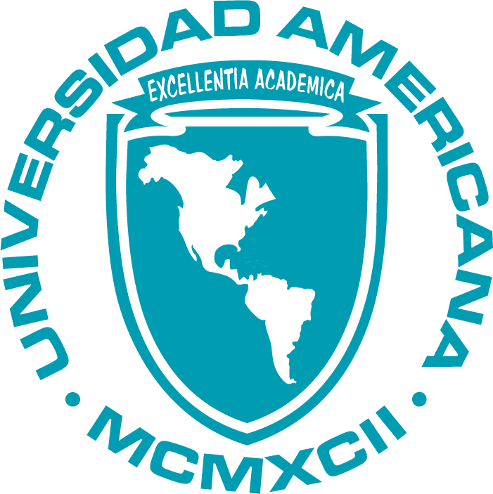
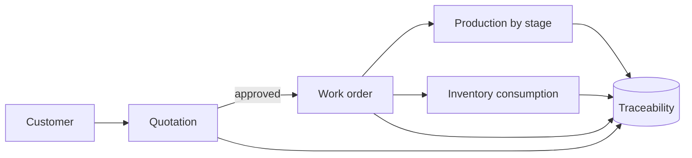
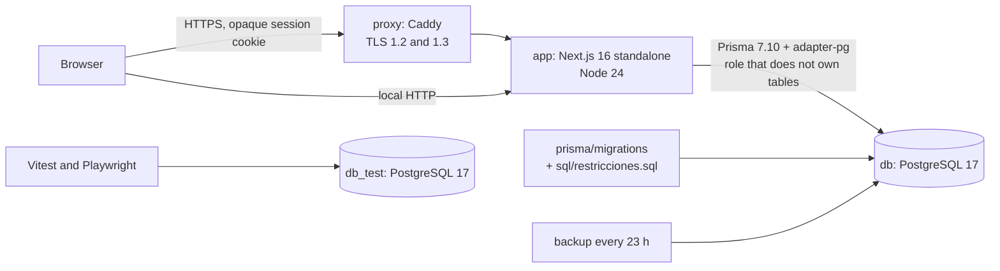

<div align="center">

[Español](README.md) | **English**



<br>


<br>

<p align="center">
  
  &nbsp;&nbsp;&nbsp;&nbsp;
  
  &nbsp;&nbsp;&nbsp;&nbsp;
  
</p>

</div>

---

## What TRACORE is

TRACORE is a web management platform for **Soluciones Creativas**, a company in Estelí, Nicaragua.
It is the pilot of the Capstone Project (PCE, Proyecto de Culminación de Estudios) at Universidad Americana (UAM).

### The problem

The data of a job lives in separate places.
The quotation, the work order, the material and the production progress are not connected.
This causes rework, delays from missing material and little visibility of the real cost.

### The solution

TRACORE follows each job from start to finish with a single record.
An approved quotation becomes a work order without retyping.
The order consumes inventory and moves through stages.
Every change is kept in a log that cannot be overwritten.



---

## Modules

| Module | What it does |
|---|---|
| Customers | Records customers with a unique code, tax ID (RUC) and the full history of quotations and orders. |
| Catalog and quotations | Quotes catalog products and custom jobs with variable costs. Handles cordobas (NIO) and dollars (USD). |
| Work orders | Converts an approved quotation into a single order with the same data. |
| Inventory | Controls stock through a movement ledger: entries, consumption, returns and adjustments. |
| Production | Assigns an owner and a date to each stage. Records every change in a history. |
| Traceability | Shows in chronological order who changed what and when. |
| Dashboard and reports | Shows pending quotations, materials and workload. Exports to Excel. |
| Administration | Manages users, profiles, permissions and settings. |

---

## Highlighted features

| Feature | Detail |
|---|---|
| Live search | Filters lists while the user types. |
| Operational dashboard per profile | Each profile sees the indicators of its own work. |
| Quotation drawer | Opens the quotation in a side panel without leaving the list. |
| Permissions per profile | Six profiles, 30 permissions and 62 grants. Users with several profiles get the union of permissions. |
| System status | Shows performance, database, process and access events of the last 24 hours, with alerts. |
| Customer logo | Each customer can show its logo on the record. |
| Global search | Returns results only from the modules the profile can see. |
| Reports and Excel | Reports with Excel export protected by permission. |
| Accessibility | axe tests against WCAG 2.2 AA. Keyboard navigation. |
| Four screen widths | Tested at 768, 1024, 1366 and 1920 px. |

---

## Technologies

<p align="center">
  
</p>

| Layer | Technology | Version |
|---|---|---|
| UI | Next.js (App Router) | 16.3.8 |
| UI | React | 19.3.0 |
| Language | TypeScript (strict mode) | 5.x |
| Styling | Tailwind CSS, shadcn/ui and Radix | 4.x |
| Forms and validation | react-hook-form and zod | 7.89 and 4.4 |
| Data access | Prisma with `@prisma/adapter-pg` | 7.10.0 |
| Database | PostgreSQL | 17 |
| Security | argon2id (`@node-rs/argon2`), rate limiting and Caddy proxy with TLS | 2.x, 11.x and 2 |
| Logging | pino | 10.x |
| Excel | exceljs | 4.4 |
| Testing | Vitest, Playwright and axe-core | 4.1, 1.63 and 4.13 |
| Quality | ESLint, Squawk and gitleaks | 9.x |
| Runtime | Node.js in Docker and Docker Compose | 24 |
| Packages | pnpm | 11.1.1 |
| Continuous integration | GitHub Actions | n/a |

---

## How it is developed

<details>
<summary><b>Modular architecture</b></summary>

<br>

The code separates rules, modules and routes.

| Folder | Responsibility |
|---|---|
| `src/core/` | Pure rules: permissions, authorization and costing. No Next and no database. |
| `src/modules/<module>/` | `service.ts`, `schema.ts` (zod), `repo.ts` and module components. |
| `src/app/` | Routes and pages. The API lives in `api/v1/<resource>/route.ts`. |
| `src/components/` | Design system (`ui/`) and layout pieces. |
| `src/lib/` | Database, authentication, errors, HTTP and formatting. |
| `prisma/` | Schema, migrations, SQL constraints and seed data. |



</details>

<details>
<summary><b>API with <code>manejar</code> and permissions</b></summary>

<br>

Every route goes through `manejar`. The handler stays thin.

1. Checks the origin on write requests.
2. Loads the session. Without a session it answers 401.
3. Checks the permission. Without permission it answers 403.
4. Validates the input with zod. Invalid input answers 400 or 422.
5. Calls the service and answers `{ "datos": ... }`.
6. Translates database errors (SC001 to SC007) into 409 with a readable message.

The server decides authorization with `can(actor, "resource:action")`.
The interface only hides options.
Every business change writes its log row inside the same transaction.

</details>

<details>
<summary><b>Database, Prisma and migrations</b></summary>

<br>

- Integrity rules live in PostgreSQL: `CHECK`, triggers and a state transition table (ADR-003).
- The application uses a role that does not own the tables. Triggers also protect against the application itself (ADR-009).
- The log, the inventory movements and the stage history accept inserts only.
- Each order comes from an approved quotation. One quotation produces one order.
- Migrations are reviewed with **Squawk** before every push.
- Each migration that changes data ships with its rollback in `prisma/migrations-down/`.

</details>

<details>
<summary><b>Design</b></summary>

<br>

- Color tokens in `src/app/globals.css`, exposed through Tailwind 4 (`@theme inline`).
- Main color navy `#1f2a6b`. Gold `#c9962f` marks only occasional accents.
- Bento style: cards with 6 px radius, soft borders and 4 px spacing.
- Bundled Inter typeface. The build does not depend on the internet.
- States combine color, icon and text.
- Three menu widths: full sidebar, icon rail and mobile panel.
- Honors `prefers-reduced-motion`.

See [docs/diseno.md](docs/diseno.md) (in Spanish).

</details>

<details>
<summary><b>Quality and testing</b></summary>

<br>

| Check | Tool |
|---|---|
| Types | `tsc --noEmit` (`pnpm typecheck`) |
| Style | ESLint (`pnpm lint`) |
| Unit and integration tests | Vitest, against a real PostgreSQL with one database per section |
| E2E tests | Playwright per profile, at 4 widths |
| Accessibility | axe with WCAG 2.2 AA tags |
| Performance | `scripts/rendimiento.mjs` with 20 concurrent sessions |
| Secrets | gitleaks over the full history |
| Migrations | Squawk |
| Dependencies | `pnpm audit` blocks CRITICAL findings |
| Cycles and layers | `scripts/auditoria/ciclos.mjs` |

Tests are split into 10 sections, one per module.
Each section uses its own `seccion_<name>_test` database.

**Before every push** the team runs `pnpm ci:local`.
It repeats the CI steps on the local machine: style, types, build, audit, gitleaks, Squawk and the test sections.
**GitHub Actions** runs the same flow on every `push` and `pull_request`.

</details>

<details>
<summary><b>Verified results</b></summary>

<br>

| Measure | Result |
|---|---|
| Requirements of traceability matrix v9 (RF, RNF and RB) | 28 covered, 0 partial, 0 pending |
| RNF-01 Response time | 20 concurrent sessions, 60 s, 14,850 operations |
| RNF-01 95th percentile | 106.54 ms (limit: 2 s), 100 % within 2 s, 0 errors and 0 responses 429 |
| RNF-08 Adaptability | 24 overlap tests at 768, 1024, 1366 and 1920 px, all passing |
| RNF-07 Recoverability | Restore in 2 s with demo data (limit: 4 hours) |
| Permission matrix | 6 profiles, 30 permissions and 62 grants |

Details in [docs/trazabilidad.md](docs/trazabilidad.md) (in Spanish).

</details>

---

## Academic team

| | |
|---|---|
| University | Universidad Americana (UAM) |
| Faculty | Faculty of Engineering and Architecture |
| Program | Systems Engineering (Ingeniería en Sistemas) |
| Work | Capstone Project (PCE, Proyecto de Culminación de Estudios), 2026 |
| Authors | Norman Smith Martínez Acevedo and Jorge Alí Rodríguez |
| Advisor | Dr. Carlos Alexander Mendoza Jacomino |
| Case study | Soluciones Creativas, Estelí, Nicaragua |

---

## Run locally

The repository is private. Sign in to GitHub before cloning.
You need Docker with Docker Compose v2.

```sh
git clone https://github.com/NormanSMA/Tesis-SC.git
cd Tesis-SC
docker compose up -d --build
```

You do not need to create `.env`: Compose reads the base values from `.env.example`.
The command starts the database, applies the migrations, loads demo data and starts the application.
It also starts the `respaldo` (backup) service.

- Application: http://127.0.0.1:3000
- Status: http://127.0.0.1:3000/api/v1/salud

<details>
<summary><b>Test users</b></summary>

<br>

Passwords are in `.env.example`.

| Profile | Email | Password variable |
|---|---|---|
| Management (Gerencia) | gerardo.jimenez@solucionescreativas.test | `SEED_PASSWORD_GERENCIA` |
| Customer service (Atención al cliente) | valentina.castro@solucionescreativas.test | `SEED_PASSWORD_ATENCION_CLIENTE` |
| Operations (Operaciones) | karla.reyes@solucionescreativas.test | `SEED_PASSWORD_OPERACIONES` |
| Administration (Administración) | luis.mendoza@solucionescreativas.test | `SEED_PASSWORD_ADMINISTRACION` |
| Production (Producción) | marco.lopez@solucionescreativas.test | `SEED_PASSWORD_PRODUCCION` |
| Technical administration (Administración técnica) | roberto.diaz@solucionescreativas.test | `SEED_PASSWORD_ADMIN` |

The current matrix has six profiles, 30 permissions and 62 grants.
The count comes from `PERMISOS_POR_PERFIL` in `src/core/permisos.ts`.
A user can have several profiles. Their effective permissions form a union.

</details>

<details>
<summary><b>Tests, continuous integration and cleanup</b></summary>

<br>

```sh
pnpm install
pnpm db:generate
pnpm typecheck
pnpm lint
docker compose --profile test up -d db_test
TEST_DATABASE_URL=postgresql://sc_owner:<password>@127.0.0.1:5443/<name>_test?schema=public pnpm test
pnpm e2e
```

The test database name must end in `_test`. The suite erases its content.

GitHub Actions runs `.github/workflows/ci.yml` on every `push` and `pull_request`.
It uses Node 24 and the pnpm version from `packageManager`.
It runs `pnpm lint`, `pnpm typecheck`, `pnpm test` and `pnpm build`.
E2E tests need browsers and a seeded application. They run in a separate workflow.

```sh
docker compose stop        # keeps the data
docker compose down -v     # removes containers and data
```

The `respaldo` service saves a copy at startup and every 23 hours.
Read its log with `docker compose exec respaldo cat /respaldos/registro.log`.

</details>

---

## Documentation

The documents below are written in Spanish.

| Document | Content |
|---|---|
| [docs/trazabilidad.md](docs/trazabilidad.md) | Requirements, tests and the status of each one. |
| [docs/arquitectura-sistema.md](docs/arquitectura-sistema.md) | Context, layers, transactions and state machines. |
| [docs/decisiones.md](docs/decisiones.md) | Decision log (ADR-001 to ADR-021). |
| [docs/tecnologias.md](docs/tecnologias.md) | Libraries, purpose and evaluated alternatives. |
| [docs/diseno.md](docs/diseno.md) | Tokens, components and WCAG 2.2 AA map. |
| [docs/modulos/](docs/modulos/) | Design of each module. |
| [docs/modulos/09-perfiles-v9.md](docs/modulos/09-perfiles-v9.md) | Profile matrix. |
| [docs/seed.md](docs/seed.md) | Demo data. |
| [docs/seguridad.md](docs/seguridad.md) | Security controls. |
| [AGENTS.md](AGENTS.md) | Code conventions. |

---

<div align="center">
<sub>TRACORE · Universidad Americana (UAM) · Systems Engineering · PCE 2026</sub>
</div>
