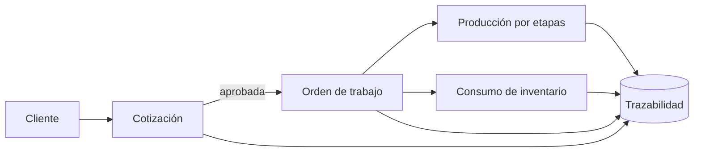
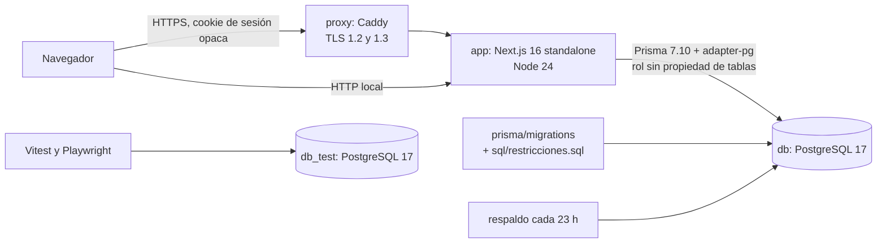

<div align="center">

**Español** | [English](README.en.md)


<br>


<br>

<p align="center">
  
  &nbsp;&nbsp;&nbsp;&nbsp;
  
  &nbsp;&nbsp;&nbsp;&nbsp;
  
</p>

</div>

---

## Qué es TRACORE

TRACORE es una plataforma web de gestión para **Soluciones Creativas**, empresa de Estelí, Nicaragua.
Es el piloto del Proyecto de Culminación de Estudios (PCE) de la Universidad Americana (UAM).

### El problema

Los datos de un trabajo viven en lugares separados.
La cotización, la orden, el material y el avance de producción no se conectan.
Eso causa retrabajo, retrasos por falta de material y poca visibilidad del costo real.

### La solución

TRACORE sigue cada trabajo de principio a fin con un solo registro.
Una cotización aprobada se convierte en orden sin volver a digitar.
La orden consume inventario y avanza por etapas.
Cada cambio queda en una bitácora que no se puede sobrescribir.



---

## Módulos

| Módulo | Qué hace |
|---|---|
| Clientes | Registra clientes con código único, RUC e historial completo de cotizaciones y órdenes. |
| Catálogo y cotizaciones | Cotiza productos de catálogo y trabajos personalizados con costos variables. Maneja córdobas (NIO) y dólares (USD). |
| Órdenes de trabajo | Convierte una cotización aprobada en una sola orden, con los mismos datos. |
| Inventario | Controla existencias mediante un libro de movimientos: entradas, consumos, devoluciones y ajustes. |
| Producción | Asigna responsable y fecha a cada etapa. Registra cada cambio en un historial. |
| Trazabilidad | Consulta en orden cronológico quién cambió qué y cuándo. |
| Panel y reportes | Muestra cotizaciones pendientes, materiales y carga de trabajo. Exporta a Excel. |
| Administración | Gestiona usuarios, perfiles, permisos y configuración. |

---

## Funciones destacadas

| Función | Detalle |
|---|---|
| Búsqueda en vivo | Filtra listas mientras se escribe. |
| Panel operativo por perfil | Cada perfil ve los indicadores de su trabajo. |
| Drawer de cotización | Abre la cotización en un panel lateral sin salir de la lista. |
| Permisos por perfil | Seis perfiles, 30 permisos y 62 concesiones. La unión de permisos aplica a usuarios con varios perfiles. |
| Estado del sistema | Muestra rendimiento, base de datos, proceso y accesos de las últimas 24 horas, con alertas. |
| Logo de clientes | Cada cliente puede mostrar su logo en la ficha. |
| Buscador global | Solo devuelve resultados de los módulos que el perfil puede ver. |
| Reportes y Excel | Reportes con exportación a Excel protegida por permiso. |
| Accesibilidad | Pruebas con axe sobre WCAG 2.2 AA. Navegación por teclado. |
| Cuatro anchos de pantalla | Probado en 768, 1024, 1366 y 1920 px. |

---

## Tecnologías

<p align="center">
  
</p>

| Capa | Tecnología | Versión |
|---|---|---|
| Interfaz | Next.js (App Router) | 16.3.8 |
| Interfaz | React | 19.3.0 |
| Lenguaje | TypeScript (modo estricto) | 5.x |
| Estilos | Tailwind CSS, shadcn/ui y Radix | 4.x |
| Formularios y validación | react-hook-form y zod | 7.89 y 4.4 |
| Acceso a datos | Prisma con `@prisma/adapter-pg` | 7.10.0 |
| Base de datos | PostgreSQL | 17 |
| Seguridad | argon2id (`@node-rs/argon2`), límite de tasa y proxy Caddy con TLS | 2.x, 11.x y 2 |
| Registro | pino | 10.x |
| Excel | exceljs | 4.4 |
| Pruebas | Vitest, Playwright y axe-core | 4.1, 1.63 y 4.13 |
| Calidad | ESLint, Squawk y gitleaks | 9.x |
| Ejecución | Node.js en Docker y Docker Compose | 24 |
| Paquetes | pnpm | 11.1.1 |
| Integración continua | GitHub Actions | n/a |

---

## Cómo se desarrolla

<details>
<summary><b>Arquitectura por módulos</b></summary>

<br>

El código separa reglas, módulos y rutas.

| Carpeta | Responsabilidad |
|---|---|
| `src/core/` | Reglas puras: permisos, autorización y costeo. Sin Next ni base de datos. |
| `src/modules/<módulo>/` | `service.ts`, `schema.ts` (zod), `repo.ts` y componentes del módulo. |
| `src/app/` | Rutas y páginas. La API vive en `api/v1/<recurso>/route.ts`. |
| `src/components/` | Sistema de diseño (`ui/`) y piezas de layout. |
| `src/lib/` | Base de datos, autenticación, errores, HTTP y formato. |
| `prisma/` | Esquema, migraciones, restricciones SQL y siembra. |



</details>

<details>
<summary><b>API con <code>manejar</code> y permisos</b></summary>

<br>

Cada ruta pasa por `manejar`. El handler es delgado.

1. Verifica el origen en las escrituras.
2. Carga la sesión. Sin sesión responde 401.
3. Verifica el permiso. Sin permiso responde 403.
4. Valida la entrada con zod. Una entrada inválida responde 400 o 422.
5. Llama al servicio y responde `{ "datos": ... }`.
6. Traduce los errores de la base (SC001 a SC007) a 409 con mensaje legible.

El servidor decide la autorización con `can(actor, "recurso:accion")`.
La interfaz solo oculta opciones.
Todo cambio de negocio escribe su fila en bitácora dentro de la misma transacción.

</details>

<details>
<summary><b>Base de datos, Prisma y migraciones</b></summary>

<br>

- Las reglas de integridad viven en PostgreSQL: `CHECK`, triggers y tabla de transiciones de estado (ADR-003).
- La aplicación usa un rol que no es dueño de las tablas. Los triggers protegen también contra la propia aplicación (ADR-009).
- La bitácora, los movimientos de inventario y el historial de etapas aceptan solo inserciones.
- Cada orden nace de una cotización aprobada. Una cotización genera una sola orden.
- Las migraciones se revisan con **Squawk** antes de cada push.
- Cada migración que cambia datos incluye su reversión en `prisma/migrations-down/`.

</details>

<details>
<summary><b>Diseño</b></summary>

<br>

- Tokens de color en `src/app/globals.css`, expuestos con Tailwind 4 (`@theme inline`).
- Color principal azul marino `#1f2a6b`. El dorado `#c9962f` solo marca acentos puntuales.
- Estilo bento: tarjetas con radio de 6 px, bordes suaves y espaciado de 4 px.
- Tipografía Inter empaquetada. El build no depende de internet.
- Los estados combinan color, ícono y texto.
- Tres anchos de menú: lateral completo, riel de íconos y panel móvil.
- Respeta `prefers-reduced-motion`.

Consulte [docs/diseno.md](docs/diseno.md).

</details>

<details>
<summary><b>Calidad y pruebas</b></summary>

<br>

| Control | Herramienta |
|---|---|
| Tipos | `tsc --noEmit` (`pnpm typecheck`) |
| Estilo | ESLint (`pnpm lint`) |
| Pruebas unitarias y de integración | Vitest, contra PostgreSQL real con una base propia por sección |
| Pruebas E2E | Playwright por perfil, en 4 anchos |
| Accesibilidad | axe con etiquetas WCAG 2.2 AA |
| Rendimiento | `scripts/rendimiento.mjs` con 20 sesiones concurrentes |
| Secretos | gitleaks sobre el historial completo |
| Migraciones | Squawk |
| Dependencias | `pnpm audit` bloquea los CRITICAL |
| Ciclos y capas | `scripts/auditoria/ciclos.mjs` |

Las pruebas se reparten en 10 secciones por módulo.
Cada una usa su propia base `seccion_<nombre>_test`.

**Antes de cada push** se ejecuta `pnpm ci:local`.
Repite en el equipo los pasos del CI: estilo, tipos, compilación, auditoría, gitleaks, Squawk y las secciones de pruebas.
**GitHub Actions** ejecuta el mismo flujo en cada `push` y `pull_request`.

</details>

<details>
<summary><b>Resultados verificados</b></summary>

<br>

| Medida | Resultado |
|---|---|
| Requisitos de la matriz v9 (RF, RNF y RB) | 28 cubiertos, 0 parciales, 0 pendientes |
| RNF-01 Tiempo de respuesta | 20 sesiones concurrentes, 60 s, 14 850 operaciones |
| RNF-01 Percentil 95 | 106,54 ms (límite: 2 s), 100 % en 2 s o menos, 0 errores y 0 respuestas 429 |
| RNF-08 Adaptabilidad | 24 pruebas de superposición en 768, 1024, 1366 y 1920 px, en verde |
| RNF-07 Recuperabilidad | Restauración en 2 s con datos de demostración (límite: 4 horas) |
| Matriz de permisos | 6 perfiles, 30 permisos y 62 concesiones |

Detalle en [docs/trazabilidad.md](docs/trazabilidad.md).

</details>

---

## Equipo académico

| | |
|---|---|
| Universidad | Universidad Americana (UAM) |
| Facultad | Facultad de Ingeniería y Arquitectura |
| Carrera | Ingeniería en Sistemas |
| Trabajo | Proyecto de Culminación de Estudios (PCE), 2026 |
| Autores | Norman Smith Martínez Acevedo y Jorge Alí Rodríguez |
| Tutor | Dr. Carlos Alexander Mendoza Jacomino |
| Caso de estudio | Soluciones Creativas, Estelí, Nicaragua |

---

## Ejecutar en local

El repositorio es privado. Inicie sesión en GitHub antes de clonar.
Necesita Docker con Docker Compose v2.

```sh
git clone https://github.com/NormanSMA/Tesis-SC.git
cd Tesis-SC
docker compose up -d --build
```

No hace falta crear `.env`: Compose lee los valores base de `.env.example`.
El comando levanta la base de datos, aplica las migraciones, carga datos de demostración e inicia la aplicación.
También inicia el servicio `respaldo`.

- Aplicación: http://127.0.0.1:3000
- Estado: http://127.0.0.1:3000/api/v1/salud

<details>
<summary><b>Usuarios de prueba</b></summary>

<br>

Las contraseñas están en `.env.example`.

| Perfil | Correo | Variable de la clave |
|---|---|---|
| Gerencia | gerardo.jimenez@solucionescreativas.test | `SEED_PASSWORD_GERENCIA` |
| Atención al cliente | valentina.castro@solucionescreativas.test | `SEED_PASSWORD_ATENCION_CLIENTE` |
| Operaciones | karla.reyes@solucionescreativas.test | `SEED_PASSWORD_OPERACIONES` |
| Administración | luis.mendoza@solucionescreativas.test | `SEED_PASSWORD_ADMINISTRACION` |
| Producción | marco.lopez@solucionescreativas.test | `SEED_PASSWORD_PRODUCCION` |
| Administración técnica | roberto.diaz@solucionescreativas.test | `SEED_PASSWORD_ADMIN` |

La matriz vigente contiene seis perfiles, 30 permisos y 62 concesiones.
El conteo procede de `PERMISOS_POR_PERFIL` en `src/core/permisos.ts`.
Un usuario puede tener varios perfiles. Sus permisos efectivos forman una unión.

</details>

<details>
<summary><b>Pruebas, integración continua y limpieza</b></summary>

<br>

```sh
pnpm install
pnpm db:generate
pnpm typecheck
pnpm lint
docker compose --profile test up -d db_test
TEST_DATABASE_URL=postgresql://sc_owner:<clave>@127.0.0.1:5443/<nombre>_test?schema=public pnpm test
pnpm e2e
```

La base de pruebas debe terminar en `_test`. La suite borra su contenido.

GitHub Actions ejecuta `.github/workflows/ci.yml` en cada `push` y `pull_request`.
Usa Node 24 y la versión de pnpm de `packageManager`.
Ejecuta `pnpm lint`, `pnpm typecheck`, `pnpm test` y `pnpm build`.
Los E2E requieren navegadores y una aplicación con siembra. Corren en un flujo separado.

```sh
docker compose stop        # conserva los datos
docker compose down -v     # elimina contenedores y datos
```

El servicio `respaldo` guarda una copia al arrancar y cada 23 horas.
Consulte el registro con `docker compose exec respaldo cat /respaldos/registro.log`.

</details>

---

## Documentación

| Documento | Contenido |
|---|---|
| [docs/trazabilidad.md](docs/trazabilidad.md) | Requisitos, pruebas y estado de cada uno. |
| [docs/arquitectura-sistema.md](docs/arquitectura-sistema.md) | Contexto, capas, transacciones y máquinas de estado. |
| [docs/decisiones.md](docs/decisiones.md) | Registro de decisiones (ADR-001 a ADR-021). |
| [docs/tecnologias.md](docs/tecnologias.md) | Librerías, propósito y alternativas evaluadas. |
| [docs/diseno.md](docs/diseno.md) | Tokens, componentes y mapa WCAG 2.2 AA. |
| [docs/modulos/](docs/modulos/) | Diseño de cada módulo. |
| [docs/modulos/09-perfiles-v9.md](docs/modulos/09-perfiles-v9.md) | Matriz de perfiles. |
| [docs/seed.md](docs/seed.md) | Datos de demostración. |
| [docs/seguridad.md](docs/seguridad.md) | Controles de seguridad. |
| [AGENTS.md](AGENTS.md) | Convenciones de código. |

---

<div align="center">
<sub>TRACORE · Universidad Americana (UAM) · Ingeniería en Sistemas · PCE 2026</sub>
</div>
