# 05. Modelo de datos del piloto

Fecha: 2026-10-05. Estado: propuesta para aprobación de Fase 1.
Archivos: `prisma/schema.prisma` y `prisma/sql/restricciones.sql`.
Stack: PostgreSQL 17, Prisma 7.10.0 con `@prisma/adapter-pg`, TypeScript.

Convenciones:
- Modelos en PascalCase y campos en camelCase, en español sin tildes.
- Tablas y columnas en snake_case mediante `@@map` y `@map`.
- Claves primarias UUID generadas por `gen_random_uuid()` en el servidor.
- Excepciones: `UsuarioPerfil` y `PerfilPermiso` usan claves compuestas; `Contador` usa `(tipo, anio)`.
- Use `solicitud_idempotente.clave` como clave primaria UUID proporcionada, sin valor predeterminado.
- Instantes en `timestamptz`. Fechas de calendario en `date` (ver D-13).
- Dinero `Decimal(14,2)`. Cantidades `Decimal(14,3)`. Porcentajes `Decimal(5,2)`.
- Costos unitarios y `material.costo_promedio`: `Decimal(14,4)` (ver D-14).
- Claves foráneas con `ON DELETE RESTRICT`, salvo `usuario_perfil.usuario_id` con `CASCADE`.

Fuentes citadas: secciones 1.7 y 2.6 del documento V6, Anexo C (P1 a P11, Tablas C2 y C3), Anexo D (CF-01 a CF-11).
Supuestos S-01 a S-11 vienen del plan. SD-12 a SD-25 son supuestos de datos de este documento. Su relación con docs/supuestos.md está en ese archivo.

---

## (a) Diagrama entidad-relación

```mermaid
erDiagram
    Perfil ||--o{ UsuarioPerfil : "asigna"
    Usuario ||--o{ UsuarioPerfil : "tiene"
    Usuario |o--o{ UsuarioPerfil : "asigna"
    Perfil ||--o{ PerfilPermiso : "concede"
    Permiso ||--o{ PerfilPermiso : "se concede en"
    Usuario |o--o{ PerfilPermiso : "otorga"
    Usuario ||--o{ Sesion : "abre"

    Cliente ||--o{ Cotizacion : "solicita"
    Usuario ||--o{ Cotizacion : "elabora"
    Cotizacion |o--o{ Cotizacion : "se duplica en"
    Cotizacion ||--o{ ItemCotizacion : "contiene"
    ItemCotizacion ||--o{ LineaCosto : "se costea con"
    Producto |o--o{ ItemCotizacion : "se cotiza en"
    Categoria ||--o{ ItemCotizacion : "clasifica"
    Categoria ||--o{ Producto : "agrupa"
    Producto ||--o{ RecetaProducto : "requiere"
    Material ||--o{ RecetaProducto : "compone"
    Material |o--o{ LineaCosto : "valora"

    Cotizacion ||--o| OrdenTrabajo : "genera"
    Categoria ||--o{ OrdenTrabajo : "tipifica"
    Cliente ||--o{ OrdenTrabajo : "solicita"
    Usuario |o--o{ OrdenTrabajo : "responde por"
    OrdenTrabajo ||--o{ EtapaOrden : "se ejecuta en"
    Categoria ||--o{ EtapaPlantilla : "define"
    Area ||--o{ EtapaPlantilla : "ejecuta"
    EtapaPlantilla |o--o{ EtapaOrden : "instancia"
    Area ||--o{ EtapaOrden : "carga"
    Usuario |o--o{ EtapaOrden : "ejecuta"

    Material ||--o{ MovimientoInventario : "registra"
    Usuario ||--o{ MovimientoInventario : "registra"
    MovimientoInventario ||--o| ConsumoOrden : "se imputa en"
    OrdenTrabajo ||--o{ ConsumoOrden : "consume"
    Material ||--o{ ConsumoOrden : "se consume en"
    OrdenTrabajo ||--o{ ConsumoEstimado : "prevé"
    Material ||--o{ ConsumoEstimado : "se prevé en"

    OrdenTrabajo |o--o{ Bitacora : "historial"
    Cotizacion |o--o{ Bitacora : "historial"
    Usuario ||--o{ Bitacora : "actúa en"
    Usuario |o--o{ Configuracion : "edita"

    Perfil {
        uuid id PK
        CodigoPerfil codigo UK
        varchar nombre
        text descripcion
    }
    Permiso {
        uuid id PK
        varchar recurso
        varchar accion
        text descripcion
    }
    PerfilPermiso {
        uuid perfilId PK,FK
        uuid permisoId PK,FK
        uuid otorgadoPorId FK
        timestamptz creadoEn
    }
    UsuarioPerfil {
        uuid usuarioId PK,FK
        uuid perfilId PK,FK
        uuid asignadoPorId FK
        timestamptz creadoEn
    }
    Usuario {
        uuid id PK
        varchar nombre
        varchar correo UK
        text hashContrasena
        boolean activo
        int intentosFallidos
        timestamptz bloqueadoHasta
        timestamptz ultimoAcceso
        timestamptz creadoEn
        timestamptz actualizadoEn
    }
    Sesion {
        uuid id PK
        char tokenHash UK
        uuid usuarioId FK
        timestamptz creadoEn
        timestamptz expiraEn
        timestamptz revocadaEn
    }
    Cliente {
        uuid id PK
        varchar nombre
        TipoCliente tipo
        varchar ruc UK
        varchar contactoPrincipal
        varchar telefono
        varchar correo
        text direccion
        text notas
        boolean activo
        timestamptz creadoEn
        timestamptz actualizadoEn
    }
    Categoria {
        uuid id PK
        varchar nombre UK
        text descripcion
        boolean activo
    }
    Area {
        uuid id PK
        varchar nombre UK
        boolean activo
    }
    Producto {
        uuid id PK
        varchar codigo UK
        varchar nombre
        text descripcion
        uuid categoriaId FK
        UnidadCobro unidadCobro
        decimal precioBase
        boolean activo
    }
    RecetaProducto {
        uuid id PK
        uuid productoId FK
        uuid materialId FK
        decimal cantidad
    }
    Material {
        uuid id PK
        varchar codigo UK
        varchar nombre
        UnidadMaterial unidad
        decimal existencia
        decimal costoPromedio
        decimal stockMinimo
        boolean activo
    }
    MovimientoInventario {
        uuid id PK
        uuid materialId FK
        TipoMovimiento tipo
        decimal cantidad
        decimal costoUnitario
        decimal existenciaResultante
        decimal costoPromedioResultante
        text motivo
        varchar referencia
        uuid usuarioId FK
        timestamptz creadoEn
    }
    ConsumoOrden {
        uuid id PK
        uuid ordenId FK
        uuid materialId FK
        uuid movimientoId FK,UK
    }
    ConsumoEstimado {
        uuid id PK
        uuid ordenId FK
        uuid materialId FK
        decimal cantidad
        OrigenEstimado origen
        timestamptz creadoEn
    }
    Cotizacion {
        uuid id PK
        varchar numero UK
        uuid clienteId FK
        EstadoCotizacion estado
        varchar asunto
        text condiciones
        uuid cotizacionOrigenId FK
        char moneda
        decimal tasaImpuesto
        decimal subtotal
        decimal descuento
        decimal impuesto
        decimal total
        decimal margenPct
        int vigenciaDias
        date fechaEmision
        date fechaVencimiento
        timestamptz fechaRespuesta
        text motivoRechazo
        boolean archivada
        uuid creadoPorId FK
        timestamptz creadoEn
    }
    ItemCotizacion {
        uuid id PK
        uuid cotizacionId FK
        int secuencia
        TipoItem tipo
        uuid productoId FK
        uuid categoriaId FK
        text descripcion
        UnidadCobro unidadCobro
        decimal cantidad
        decimal ancho
        decimal alto
        decimal precioUnitario
        decimal costoTotal
        decimal margenPct
        decimal importe
    }
    LineaCosto {
        uuid id PK
        uuid itemId FK
        int secuencia
        TipoLineaCosto tipo
        text descripcion
        uuid materialId FK
        varchar unidad
        decimal cantidad
        decimal costoUnitario
        decimal mermaPct
        decimal importe
    }
    OrdenTrabajo {
        uuid id PK
        varchar numero UK
        uuid cotizacionId FK,UK
        uuid clienteId FK
        uuid categoriaId FK
        EstadoOrden estado
        uuid responsableId FK
        text especificaciones
        date fechaEntrega
        timestamptz fechaInicioReal
        timestamptz fechaEntregaReal
        timestamptz fechaCierre
        text motivoCancelacion
        uuid creadoPorId FK
        timestamptz creadoEn
    }
    EtapaPlantilla {
        uuid id PK
        uuid categoriaId FK
        uuid areaId FK
        int secuencia
        varchar nombre
        boolean activo
    }
    EtapaOrden {
        uuid id PK
        uuid ordenId FK
        uuid plantillaId FK
        uuid areaId FK
        int secuencia
        varchar nombre
        EstadoEtapa estado
        uuid responsableId FK
        date fechaInicioPlan
        date fechaFinPlan
        timestamptz fechaInicioReal
        timestamptz fechaFinReal
        text observaciones
    }
    Bitacora {
        uuid id PK
        EntidadBitacora entidad
        uuid entidadId
        uuid ordenId FK
        uuid cotizacionId FK
        AccionBitacora accion
        varchar estadoAnterior
        varchar estadoNuevo
        uuid usuarioId FK
        timestamptz creadoEn
        jsonb detalle
    }
    Configuracion {
        uuid id PK
        varchar clave UK
        TipoValorConfig tipo
        text valor
        text descripcion
        uuid actualizadoPorId FK
        timestamptz actualizadoEn
    }
    Contador {
        TipoDocumento tipo PK
        int anio PK
        int ultimo
    }
```



Nota: `ConsumoOrden` referencia a `MovimientoInventario` con la clave compuesta `(movimientoId, materialId)`.
Así la base garantiza que el material del consumo es el del movimiento.

---

## (b) Diccionario de datos

Abreviaturas: **N** = admite nulo. **Origen**: sección de la tesis o supuesto S-xx.
Las columnas `creadoEn` y `actualizadoEn` se omiten salvo que tengan regla propia.

### Enumeraciones

| Enum | Valores | Origen |
|---|---|---|
| CodigoPerfil | GERENCIA, ATENCION_CLIENTE, PRODUCCION, ADMIN, ADMINISTRACION, OPERACIONES | ADR-014 |
| TipoCliente | PERSONA, EMPRESA | SD-12 |
| UnidadCobro | UNIDAD, M2 | 2.6 (medidas); SD-15 |
| UnidadMaterial | UNIDAD, METRO, M2, YARDA, PIE, LITRO, GALON, KILOGRAMO, LIBRA, PLIEGO, ROLLO | SD-15 |
| EstadoCotizacion | BORRADOR, ENVIADA, APROBADA, RECHAZADA, VENCIDA, AJUSTE_SOLICITADO | S-06; ADR-014 |
| TipoItem | CATALOGO, PERSONALIZADO | 1.1, 2.6; R-03 |
| TipoLineaCosto | MATERIAL, MANO_OBRA, TERCERO | R-03; SD-14 |
| EstadoOrden | PENDIENTE, EN_PRODUCCION, LISTA, ENTREGADA, CERRADA, CANCELADA | S-07 |
| EstadoEtapa | PENDIENTE, EN_CURSO, COMPLETADA, OMITIDA | 2.6; SD-16 |
| TipoMovimiento | ENTRADA, CONSUMO, AJUSTE, DEVOLUCION | 1.7; R-05; SD-19 |
| OrigenEstimado | RECETA, COTIZACION, MANUAL | S-08 |
| TipoDocumento | COTIZACION, ORDEN_TRABAJO | SD-18 |
| TipoValorConfig | TEXTO, ENTERO, DECIMAL, BOOLEANO | S-04, S-11 |
| EntidadBitacora | CLIENTE, CATEGORIA, AREA, PRODUCTO, MATERIAL, COTIZACION, ORDEN_TRABAJO, ETAPA_ORDEN, MOVIMIENTO_INVENTARIO, USUARIO, PERFIL_PERMISO, CONFIGURACION | R-07 |
| AccionBitacora | CREAR, EDITAR, CAMBIAR_ESTADO, ASIGNAR_RESPONSABLE, CONVERTIR_EN_ORDEN, REGISTRAR_ENTRADA, AJUSTAR_INVENTARIO, CONSUMIR_MATERIAL, DEVOLVER_MATERIAL, ARCHIVAR, REACTIVAR, OTORGAR_PERMISO, REVOCAR_PERMISO | R-07; P8 |

### Perfil (`perfil`)

| Columna | Tipo | N | Restricciones | Origen |
|---|---|---|---|---|
| id | uuid | no | PK | convención |
| codigo | CodigoPerfil | no | UNIQUE. Seis valores admitidos por el enum | ADR-014 |
| nombre | varchar(60) | no | | 1.7 |
| descripcion | text | sí | | S-01 |

### Permiso (`permiso`)

| Columna | Tipo | N | Restricciones | Origen |
|---|---|---|---|---|
| id | uuid | no | PK | convención |
| recurso | varchar(40) | no | UNIQUE(recurso, accion). CHECK `^[a-z][a-z_]*$` | RN-07; S-01 |
| accion | varchar(40) | no | Mismo CHECK | S-01 |
| descripcion | text | sí | | S-01 |

### PerfilPermiso (`perfil_permiso`)

| Columna | Tipo | N | Restricciones | Origen |
|---|---|---|---|---|
| perfilId | uuid | no | PK compuesta, FK perfil | F09 (Jev: documentado) |
| permisoId | uuid | no | PK compuesta, FK permiso. Índice | F09 |
| otorgadoPorId | uuid | sí | FK usuario. Nulo en el seed | S-01 |
| creadoEn | timestamptz | no | default now() | CF-05 |

Revocar un permiso borra la fila. La bitácora registra `REVOCAR_PERMISO`.
La asociación `usuario_perfil` también admite borrado físico.

### Usuario (`usuario`)

| Columna | Tipo | N | Restricciones | Origen |
|---|---|---|---|---|
| id | uuid | no | PK | convención |
| nombre | varchar(120) | no | | 1.7 |
| correo | varchar(254) | no | UNIQUE. CHECK minúsculas y contiene `@` | F21; SD-21 |
| hashContrasena | text | no | argon2id, generado en el servicio | 2.4.4 (NIST); F21 |
| activo | boolean | no | default true. Sustituye al borrado | convención |
| intentosFallidos | int | no | default 0. CHECK >= 0 | 2.4.4 (OWASP A07); SD-21 |
| bloqueadoHasta | timestamptz | sí | Bloqueo temporal tras intentos fallidos | SD-21 |
| ultimoAcceso | timestamptz | sí | | SD-21 |

### Sesion (`sesion`)

| Columna | Tipo | N | Restricciones | Origen |
|---|---|---|---|---|
| id | uuid | no | PK | convención |
| tokenHash | char(64) | no | UNIQUE. CHECK hexadecimal de 64. SHA-256 del token | F21; plan (stack) |
| usuarioId | uuid | no | FK usuario. Índice | F21 |
| expiraEn | timestamptz | no | CHECK expiraEn > creadoEn. Índice para purga | F21 |
| revocadaEn | timestamptz | sí | CHECK >= creadoEn | F21 |

Las sesiones vencidas se pueden borrar físicamente. No tienen historial de negocio.

### Cliente (`cliente`)

| Columna | Tipo | N | Restricciones | Origen |
|---|---|---|---|---|
| id | uuid | no | PK | convención |
| nombre | varchar(200) | no | CHECK no vacío. Índice (activo, nombre) | 2.6; R-13 |
| tipo | TipoCliente | no | | SD-12 |
| ruc | varchar(20) | sí | UNIQUE (admite varios nulos) | SD-12; F23 |
| contactoPrincipal | varchar(120) | sí | | SD-12 |
| telefono | varchar(30) | sí | CHECK teléfono o correo presente | SD-12 |
| correo | varchar(254) | sí | CHECK contiene `@` | SD-12 |
| direccion | text | sí | | SD-12 |
| notas | text | sí | | SD-12 |
| activo | boolean | no | default true. Sustituye al borrado | convención |

### Categoria (`categoria`)

Tipo de servicio: rotulación, gran formato, letras corpóreas, mobiliario y otros.

| Columna | Tipo | N | Restricciones | Origen |
|---|---|---|---|---|
| id | uuid | no | PK | convención |
| nombre | varchar(80) | no | UNIQUE. CHECK no vacío | 1.1; 2.6 |
| descripcion | text | sí | | 1.1 |
| activo | boolean | no | default true | convención |

### Area (`area`) — adición

Taller o área de producción: diseño, impresión, corte láser, carpintería, instalación.
Justificación: CF-06 y P7 piden carga de trabajo **por área**. Sin esta entidad no hay eje de agrupación.

| Columna | Tipo | N | Restricciones | Origen |
|---|---|---|---|---|
| id | uuid | no | PK | convención |
| nombre | varchar(80) | no | UNIQUE. CHECK no vacío | P7; SD-13 |
| activo | boolean | no | default true | convención |

### Producto (`producto`)

| Columna | Tipo | N | Restricciones | Origen |
|---|---|---|---|---|
| id | uuid | no | PK | convención |
| codigo | varchar(30) | no | UNIQUE | SD-15 |
| nombre | varchar(160) | no | | 2.6; P11 |
| descripcion | text | sí | | |
| categoriaId | uuid | no | FK categoria. Índice (categoriaId, activo) | 2.6 |
| unidadCobro | UnidadCobro | no | | 2.6; SD-15 |
| precioBase | decimal(14,2) | no | CHECK >= 0. Precio por unidad o por m2 | 2.6; R-03 |
| activo | boolean | no | default true | convención |

### RecetaProducto (`receta_producto`)

| Columna | Tipo | N | Restricciones | Origen |
|---|---|---|---|---|
| id | uuid | no | PK | convención |
| productoId | uuid | no | FK producto. UNIQUE(productoId, materialId) | S-08 |
| materialId | uuid | no | FK material. Índice | S-08 |
| cantidad | decimal(14,3) | no | CHECK > 0. Por unidad de cobro del producto | S-08 |

### Material (`material`)

| Columna | Tipo | N | Restricciones | Origen |
|---|---|---|---|---|
| id | uuid | no | PK | convención |
| codigo | varchar(30) | no | UNIQUE | 2.6; SD-15 |
| nombre | varchar(160) | no | Índice (activo, nombre) | 1.7 |
| descripcion | text | sí | | |
| unidad | UnidadMaterial | no | | SD-15 |
| existencia | decimal(14,3) | no | default 0. CHECK >= 0. Solo la escribe el trigger del libro. Alta con 0 | Tabla C2; S-09 |
| costoPromedio | decimal(14,4) | no | default 0. CHECK >= 0. Editable a mano solo con existencia 0 | S-05; D-14 |
| stockMinimo | decimal(14,3) | no | default 0. CHECK >= 0. Umbral de alerta | Tabla C2 (alertas); F01 |
| activo | boolean | no | default true | convención |

### MovimientoInventario (`movimiento_inventario`)

Libro de solo inserción. `existencia = SUM(cantidad)` por material.

| Columna | Tipo | N | Restricciones | Origen |
|---|---|---|---|---|
| id | uuid | no | PK. UNIQUE(id, materialId) como destino de FK compuesta | CF-04 |
| materialId | uuid | no | FK material. Índice (materialId, creadoEn) | R-05 |
| tipo | TipoMovimiento | no | Índice (tipo, creadoEn) | R-05; SD-19 |
| cantidad | decimal(14,3) | no | Con signo. CHECK: ENTRADA y DEVOLUCION > 0, CONSUMO < 0, AJUSTE ≠ 0 | R-05; D-02 |
| costoUnitario | decimal(14,4) | no | CHECK >= 0. Lo ingresa el usuario solo en ENTRADA. En el resto lo fija el trigger | S-05; SD-20 |
| existenciaResultante | decimal(14,3) | no | CHECK >= 0. Calculado por trigger | CF-04 |
| costoPromedioResultante | decimal(14,4) | no | Calculado por trigger | S-05 |
| motivo | text | sí | CHECK obligatorio en AJUSTE | SD-19 |
| referencia | varchar(60) | sí | Factura o guía del proveedor | SD-19 |
| usuarioId | uuid | no | FK usuario. Índice | CF-05 |
| creadoEn | timestamptz | no | default now() | CF-05 |

### ConsumoOrden (`consumo_orden`)

Une orden, material y movimiento. Registra CONSUMO y DEVOLUCION de una orden. Solo inserción.

| Columna | Tipo | N | Restricciones | Origen |
|---|---|---|---|---|
| id | uuid | no | PK | convención |
| ordenId | uuid | no | FK orden_trabajo. Índice (ordenId, materialId) | CF-03; RN-05 |
| materialId | uuid | no | FK material. Índice | CF-03 |
| movimientoId | uuid | no | UNIQUE. FK compuesta (movimientoId, materialId) → movimiento_inventario(id, materialId) | CF-03 + CF-04 |

Copie `cantidad = abs(m.cantidad)` y `costo_unitario` mediante `trg_consumo_copiar_movimiento`.
Calcule consumo neto por orden y material con `-SUM(m.cantidad)`.

### ConsumoEstimado (`consumo_estimado`) — adición

Justificación: el estimado no tiene movimiento. Mezclarlo en `ConsumoOrden` haría `movimientoId` opcional y rompería el enlace CF-03/CF-04.

| Columna | Tipo | N | Restricciones | Origen |
|---|---|---|---|---|
| id | uuid | no | PK | convención |
| ordenId | uuid | no | FK orden_trabajo. UNIQUE(ordenId, materialId) | S-08 |
| materialId | uuid | no | FK material. Índice | S-08 |
| cantidad | decimal(14,3) | no | CHECK > 0 | S-08 |
| origen | OrigenEstimado | no | RECETA (catálogo), COTIZACION (líneas MATERIAL), MANUAL | S-08 |

### Cotizacion (`cotizacion`)

| Columna | Tipo | N | Restricciones | Origen |
|---|---|---|---|---|
| id | uuid | no | PK | convención |
| numero | varchar(20) | no | UNIQUE. CHECK `COT-AAAA-NNNN`. Inmutable | F12; SD-18 |
| clienteId | uuid | no | FK cliente. Índice (clienteId, creadoEn) | 2.6; CF-11 |
| estado | EstadoCotizacion | no | default BORRADOR. Índice (estado, fechaVencimiento). Trigger de transición | S-06; CF-06 |
| asunto | varchar(200) | sí | | |
| condiciones | text | sí | Texto impreso en la proforma | F11 |
| cotizacionOrigenId | uuid | sí | FK cotizacion (duplicado). Índice | R-02; F13 |
| moneda | char(3) | no | default 'NIO'. CHECK `^[A-Z]{3}$`; no valida pertenencia a ISO 4217 | S-04 |
| tasaImpuesto | decimal(5,2) | no | CHECK 0..100. Copia del IVA vigente | S-04 |
| subtotal | decimal(14,2) | no | CHECK >= 0. Igual a Σ ítems al enviar | R-03; snapshot |
| descuento | decimal(14,2) | no | CHECK 0..subtotal. Monto global | SD-14; F14 |
| impuesto | decimal(14,2) | no | CHECK = round((subtotal − descuento) × tasa / 100, 2) | S-04 |
| total | decimal(14,2) | no | CHECK = subtotal − descuento + impuesto | snapshot |
| margenPct | decimal(5,2) | sí | CHECK 0 ≤ x < 100. Margen resultante de los ítems personalizados | SD-14 |
| vigenciaDias | int | no | CHECK > 0. Copia de configuración (15) | S-11 |
| fechaEmision | date | sí | Obligatoria fuera de BORRADOR | S-11; D-13 |
| fechaVencimiento | date | sí | CHECK = fechaEmision + vigenciaDias fuera de BORRADOR | S-11; F15 |
| fechaRespuesta | timestamptz | sí | Obligatoria en APROBADA, RECHAZADA y AJUSTE_SOLICITADO | CF-05 |
| motivoRechazo | text | sí | | |
| archivada | boolean | no | default false. Oculta borradores abandonados | convención |
| creadoPorId | uuid | no | FK usuario (vendedor). Índice (creadoPorId, estado). Inmutable | CF-05 |

Fuera de BORRADOR, `trg_cotizacion_congelar` permite cambiar estos campos:
`estado`, `fechaRespuesta`, `motivoRechazo`, `archivada`, `actualizadoEn`, `usuarioAprobacionId`, `referenciaAprobacion` y `motivoAjuste`.

### ItemCotizacion (`item_cotizacion`)

| Columna | Tipo | N | Restricciones | Origen |
|---|---|---|---|---|
| id | uuid | no | PK | convención |
| cotizacionId | uuid | no | FK cotizacion. UNIQUE(cotizacionId, secuencia) | 2.6 |
| secuencia | int | no | CHECK > 0 | |
| tipo | TipoItem | no | CHECK de coherencia con producto, costo y margen | CF-10; R-03 |
| productoId | uuid | sí | Obligatorio en CATALOGO, nulo en PERSONALIZADO | CF-10 |
| categoriaId | uuid | no | FK categoria. En catálogo se copia del producto | 2.6; SD-23 |
| descripcion | text | no | Copia del producto o texto libre | snapshot |
| unidadCobro | UnidadCobro | no | | SD-15 |
| cantidad | decimal(14,3) | no | CHECK > 0 | 2.6 |
| ancho, alto | decimal(14,3) | sí | Metros. Obligatorios con M2. CHECK > 0 | 2.6 (medidas) |
| precioUnitario | decimal(14,2) | no | CHECK >= 0. Catálogo: copia de precioBase | snapshot |
| costoTotal | decimal(14,2) | sí | Solo PERSONALIZADO. Igual a Σ líneas al enviar | R-03; CF-10 |
| margenPct | decimal(5,2) | sí | Solo PERSONALIZADO. CHECK 0 ≤ x < 100 | SD-14 |
| importe | decimal(14,2) | no | CHECK >= 0. Catálogo: CHECK de fórmula exacta | CF-10 |

Fórmulas (núcleo en `src/core/costeo.ts`):
- Catálogo UNIDAD: `importe = round(precioUnitario × cantidad, 2)`.
- Catálogo M2: `importe = round(precioUnitario × ancho × alto × cantidad, 2)`.
- Personalizado: `importe = round(costoTotal / (1 − margenPct / 100), 2)`. Sujeto a P-01.

### LineaCosto (`linea_costo`)

| Columna | Tipo | N | Restricciones | Origen |
|---|---|---|---|---|
| id | uuid | no | PK | convención |
| itemId | uuid | no | FK item_cotizacion. UNIQUE(itemId, secuencia) | R-03 |
| secuencia | int | no | CHECK > 0 | |
| tipo | TipoLineaCosto | no | | R-03; SD-14 |
| descripcion | text | no | | |
| materialId | uuid | sí | FK material. Solo con tipo MATERIAL. Índice | SD-14 |
| unidad | varchar(20) | no | Texto libre: m2, h, servicio | SD-15 |
| cantidad | decimal(14,3) | no | CHECK > 0. Horas en MANO_OBRA | R-03 |
| costoUnitario | decimal(14,4) | no | CHECK >= 0. Copia del costo promedio o tarifa | snapshot; D-14 |
| mermaPct | decimal(5,2) | no | default 0. CHECK 0..100. Distinto de 0 solo en MATERIAL | F19 |
| importe | decimal(14,2) | no | CHECK = round(cantidad × costoUnitario × (1 + merma/100), 2) | CF-10 |

### OrdenTrabajo (`orden_trabajo`)

| Columna | Tipo | N | Restricciones | Origen |
|---|---|---|---|---|
| id | uuid | no | PK | convención |
| numero | varchar(20) | no | UNIQUE. CHECK `OT-AAAA-NNNN`. Inmutable | F12; SD-18 |
| cotizacionId | uuid | no | UNIQUE. FK compuesta (cotizacionId, clienteId). Inmutable. Trigger exige APROBADA | 2.6; CF-01; RN-02 |
| categoriaId | uuid | no | FK categoria. Índice. Define la plantilla de etapas | 2.6; SD-23 |
| estado | EstadoOrden | no | default PENDIENTE. Índice (estado, fechaEntrega). Trigger de transición | S-07; CF-02 |
| responsableId | uuid | sí | FK usuario. Índice (responsableId, estado) | CF-02; ADR-014 |
| especificaciones | text | sí | Instrucciones para producción | 1.6 |
| fechaEntrega | date | no | Fecha comprometida con el cliente | CF-02; F22 |
| fechaInicioReal | timestamptz | sí | Obligatoria desde EN_PRODUCCION | CF-02 |
| fechaEntregaReal | timestamptz | sí | Obligatoria en ENTREGADA y CERRADA | CF-02 |
| fechaCierre | timestamptz | sí | Obligatoria en CERRADA | 1.7 (cierre) |
| motivoCancelacion | text | sí | Obligatorio en CANCELADA | CF-05 |
| creadoPorId | uuid | no | FK usuario. Inmutable | CF-05 |

Use `orden_trabajo.cliente_id` para relacionar directamente el cliente.
La FK compuesta garantiza el mismo cliente de la cotización.
Lea los ítems desde la cotización aprobada.

### EtapaPlantilla (`etapa_plantilla`)

| Columna | Tipo | N | Restricciones | Origen |
|---|---|---|---|---|
| id | uuid | no | PK | convención |
| categoriaId | uuid | no | FK categoria. UNIQUE(categoriaId, secuencia) | 2.6; F07 |
| areaId | uuid | no | FK area. Índice | SD-13 |
| secuencia | int | no | CHECK > 0 | F07 |
| nombre | varchar(80) | no | | F07 |
| activo | boolean | no | default true | convención |

### EtapaOrden (`etapa_orden`)

| Columna | Tipo | N | Restricciones | Origen |
|---|---|---|---|---|
| id | uuid | no | PK | convención |
| ordenId | uuid | no | FK orden_trabajo. UNIQUE(ordenId, secuencia). Inmutable | 2.6; R-06 |
| plantillaId | uuid | sí | FK etapa_plantilla. Nulo en etapas agregadas a mano | F07 |
| areaId | uuid | no | FK area. Índice (areaId, estado) | CF-06; SD-13 |
| secuencia | int | no | CHECK > 0 | R-06 |
| nombre | varchar(80) | no | Copia de la plantilla | snapshot |
| estado | EstadoEtapa | no | default PENDIENTE. Trigger de transición | 2.6; SD-16 |
| responsableId | uuid | sí | FK usuario. Índice (responsableId, estado). Obligatorio en EN_CURSO y COMPLETADA | 2.6; P7; S-03 |
| fechaInicioPlan, fechaFinPlan | date | sí | CHECK fin >= inicio | R-06 |
| fechaInicioReal | timestamptz | sí | Obligatoria en EN_CURSO y COMPLETADA. Nula en PENDIENTE y OMITIDA | R-06; P8 |
| fechaFinReal | timestamptz | sí | Obligatoria solo en COMPLETADA. CHECK fin >= inicio | R-06; P8 |
| observaciones | text | sí | | |

### Bitacora (`bitacora`)

Solo inserción. Trigger bloquea UPDATE, DELETE y TRUNCATE.

| Columna | Tipo | N | Restricciones | Origen |
|---|---|---|---|---|
| id | uuid | no | PK | convención |
| entidad | EntidadBitacora | no | Índice (entidad, entidadId, creadoEn) | R-07 |
| entidadId | uuid | no | Sin FK: referencia polimórfica | R-07 |
| ordenId | uuid | sí | FK orden_trabajo. Índice (ordenId, creadoEn). CHECK = entidadId si entidad es ORDEN_TRABAJO. Obligatorio en etapas y consumos | CF-05; CF-09 |
| cotizacionId | uuid | sí | FK cotizacion. Índice (cotizacionId, creadoEn). CHECK = entidadId si entidad es COTIZACION | CF-05 |
| accion | AccionBitacora | no | | R-07 |
| estadoAnterior | varchar(20) | sí | | P8 |
| estadoNuevo | varchar(20) | sí | Obligatorio en CAMBIAR_ESTADO | P8 |
| usuarioId | uuid | no | FK usuario (actor). Índice (usuarioId, creadoEn) | P8; CF-05 |
| creadoEn | timestamptz | no | default now(). Índice | P8 |
| detalle | jsonb | no | default '{}'. CHECK objeto JSON. Valores antes y después, motivo, cantidades | R-07 |

### Configuracion (`configuracion`)

| Columna | Tipo | N | Restricciones | Origen |
|---|---|---|---|---|
| id | uuid | no | PK | convención |
| clave | varchar(60) | no | UNIQUE. CHECK `^[a-z][a-z0-9_]*$` | S-04, S-11 |
| tipo | TipoValorConfig | no | | S-04 |
| valor | text | no | CHECK de formato según tipo | S-04 |
| descripcion | text | sí | | |
| actualizadoPorId | uuid | sí | FK usuario. Índice | CF-05 |

Claves del seed: `iva_porcentaje` (DECIMAL, 15.00), `cotizacion_vigencia_dias` (ENTERO, 15), `moneda` (TEXTO, NIO), `empresa_nombre` (TEXTO, Soluciones Creativas), `zona_horaria` (TEXTO, America/Managua).

### Contador (`contador`)

| Columna | Tipo | N | Restricciones | Origen |
|---|---|---|---|---|
| tipo | TipoDocumento | no | PK compuesta | F12; SD-18 |
| anio | int | no | PK compuesta. CHECK 2000..9999 | SD-18 |
| ultimo | int | no | default 0. CHECK >= 0 | SD-18 |

Solo se escribe con `siguiente_numero(tipo)`.

### Supuestos nuevos

| ID | Supuesto |
|---|---|
| SD-12 | Cliente: nombre y tipo obligatorios. RUC opcional y único. Teléfono o correo obligatorio |
| SD-13 | Área de producción como catálogo editable. Cada etapa pertenece a un área |
| SD-14 | Ítem personalizado = Σ líneas (material con merma, mano de obra, terceros). Margen sobre precio de venta por ítem. Descuento como monto global |
| SD-15 | Unidades: UNIDAD o M2 para cobro. Lista cerrada para material. Texto libre en líneas de costo |
| SD-16 | Etapa sin estado BLOQUEADA |
| SD-17 | Transiciones de las tres máquinas según la sección (c) |
| SD-18 | Numeración anual por tipo, sin huecos, año según hora de Managua |
| SD-19 | DEVOLUCION = reingreso de material sobrante de una orden. Salida sin orden = AJUSTE negativo con motivo |
| SD-20 | Consumos, ajustes y devoluciones se valoran al costo promedio vigente |
| SD-21 | Inicio de sesión por correo. Bloqueo temporal tras intentos fallidos |
| SD-22 | Fechas comprometidas y planificadas como fecha de calendario |
| SD-23 | Cada orden tiene una categoría principal que define sus etapas. Se agregan etapas a mano si hace falta |
| SD-24 | Matriz inicial de la sección (c), sustituida por ADR-014 |
| SD-25 | Cotización enviada no se edita. Se corrige con un duplicado |

---

## (c) Máquinas de estado

Fuente única en la base: función `transicion_valida(maquina, desde, hacia)`.
`src/core/estados.ts` debe coincidir. Una prueba compara todos los pares contra la función.
El servicio verifica permiso y condiciones. La base rechaza toda transición fuera del grafo (SQLSTATE SC002).
Toda transición escribe una fila en `bitacora` en la misma transacción, con actor y estados.

### Catálogo inicial de permisos por defecto (SD-24, sustituido por ADR-014)

Conserve esta matriz como referencia histórica; consulte ADR-014 para el reparto v9.
G = GERENCIA, V = VENTAS (código anterior), P = PRODUCCION, A = ADMIN.

| Permiso | G | V | P | A |
|---|---|---|---|---|
| cliente:ver | x | x | | |
| cliente:gestionar | | x | | |
| catalogo:ver | x | x | x | |
| catalogo:gestionar (productos, recetas, categorías, áreas, plantillas) | x | | | |
| cotizacion:ver | x | x | | |
| cotizacion:gestionar (crear, editar borrador, duplicar, archivar) | | x | | |
| cotizacion:enviar | | x | | |
| cotizacion:responder (aprobar, rechazar, vencer) | x | x | | |
| orden:ver | x | x | x | |
| orden:crear (convertir cotización) | | x | | |
| orden:gestionar (fecha de entrega, responsable, especificaciones) | x | x | | |
| orden:avanzar | | | x | |
| orden:entregar | | x | x | |
| orden:cerrar | x | x | | |
| orden:cancelar | x | | | |
| produccion:ver | x | x | x | |
| produccion:planificar (asignar, fechas, omitir, agregar etapa) | | | x | |
| produccion:ejecutar (iniciar, completar etapa) | | | x | |
| inventario:ver | x | x | x | |
| inventario:entrada | | | x | |
| inventario:consumir (consumo y devolución) | | | x | |
| inventario:ajustar | x | | | |
| material:gestionar (alta, stock mínimo) | x | | x | |
| bitacora:ver (global) | x | | | x |
| panel:ver | x | x | x | |
| reporte:ver, reporte:exportar | x | | | |
| usuario:gestionar | | | | x |
| permiso:gestionar | | | | x |
| configuracion:gestionar | | | | x |

La línea de tiempo de una orden se ve con `orden:ver`. No requiere `bitacora:ver`.

### Cotización

| Desde | Hacia | Permiso | Condición del servicio | Efecto en datos | Bitácora |
|---|---|---|---|---|---|
| (alta) | BORRADOR | cotizacion:gestionar | Cliente activo | `numero = siguiente_numero('COTIZACION')`. Copia IVA y vigencia | CREAR, estadoNuevo BORRADOR |
| BORRADOR | ENVIADA | cotizacion:enviar | Al menos un ítem. Totales recalculados | fechaEmision = hoy. fechaVencimiento = hoy + vigencia | CAMBIAR_ESTADO |
| ENVIADA | APROBADA | cotizacion:responder | hoy ≤ fechaVencimiento | fechaRespuesta, usuarioAprobacionId, referenciaAprobacion no vacía | CAMBIAR_ESTADO, detalle.medio |
| ENVIADA | RECHAZADA | cotizacion:responder | | fechaRespuesta, motivoRechazo | CAMBIAR_ESTADO |
| ENVIADA | VENCIDA | cotizacion:responder | hoy > fechaVencimiento | | CAMBIAR_ESTADO |
| ENVIADA | AJUSTE_SOLICITADO | cotizacion:responder | Motivo no vacío | fechaRespuesta, motivoAjuste | CAMBIAR_ESTADO |

APROBADA, RECHAZADA, VENCIDA y AJUSTE_SOLICITADO son terminales.
La base rechaza transiciones fuera del grafo.
Duplicar crea un BORRADOR nuevo con `cotizacionOrigenId`. Bitácora: CREAR con detalle.origen.

### Orden de trabajo

| Desde | Hacia | Permiso | Condición del servicio | Efecto en datos | Bitácora |
|---|---|---|---|---|---|
| (alta) | PENDIENTE | orden:crear | Cotización APROBADA sin orden (también en BD) | Número OT. Etapas desde plantilla. ConsumoEstimado desde recetas y líneas MATERIAL | CONVERTIR_EN_ORDEN (ordenId y cotizacionId) |
| PENDIENTE | EN_PRODUCCION | orden:avanzar | Automático al iniciar la primera etapa | fechaInicioReal = ahora | CAMBIAR_ESTADO |
| EN_PRODUCCION | LISTA | orden:avanzar | Todas las etapas COMPLETADA u OMITIDA | | CAMBIAR_ESTADO |
| LISTA | EN_PRODUCCION | orden:avanzar | Retrabajo. Motivo obligatorio. Se agrega etapa | | CAMBIAR_ESTADO, detalle.motivo |
| LISTA | ENTREGADA | orden:entregar | | fechaEntregaReal = ahora | CAMBIAR_ESTADO |
| ENTREGADA | CERRADA | orden:cerrar | Cierre administrativo | fechaCierre = ahora | CAMBIAR_ESTADO |
| PENDIENTE, EN_PRODUCCION, LISTA | CANCELADA | orden:cancelar | Motivo obligatorio | motivoCancelacion. EN_CURSO no admite transición a OMITIDA | CAMBIAR_ESTADO, detalle.motivo |

CERRADA y CANCELADA son terminales.
Cambio de responsable o de fecha de entrega: ASIGNAR_RESPONSABLE o EDITAR, con valores antes y después.

### Etapa de producción

| Desde | Hacia | Permiso | Condición del servicio | Efecto en datos | Bitácora |
|---|---|---|---|---|---|
| (alta) | PENDIENTE | produccion:planificar | Orden no terminal | Copia nombre y área de la plantilla | CREAR (ordenId) |
| PENDIENTE | EN_CURSO | produccion:ejecutar | Responsable asignado. Orden PENDIENTE o EN_PRODUCCION | fechaInicioReal = ahora. Orden PENDIENTE pasa a EN_PRODUCCION | CAMBIAR_ESTADO |
| EN_CURSO | COMPLETADA | produccion:ejecutar | | fechaFinReal = ahora | CAMBIAR_ESTADO |
| PENDIENTE | OMITIDA | produccion:planificar | Motivo | | CAMBIAR_ESTADO, detalle.motivo |
| OMITIDA | PENDIENTE | produccion:planificar | Orden no LISTA ni terminal | | CAMBIAR_ESTADO |

Asignar responsable o fechas planificadas: ASIGNAR_RESPONSABLE o EDITAR.

### Eventos de inventario

| Operación | Permiso | Movimiento | Enlace | Bitácora |
|---|---|---|---|---|
| Entrada por compra | inventario:entrada | ENTRADA, cantidad > 0, costo | | REGISTRAR_ENTRADA (MOVIMIENTO_INVENTARIO) |
| Consumo para una orden | inventario:consumir | CONSUMO, cantidad < 0 | ConsumoOrden | CONSUMIR_MATERIAL (ordenId) |
| Devolución de sobrante | inventario:consumir | DEVOLUCION, cantidad > 0 | ConsumoOrden | DEVOLVER_MATERIAL (ordenId) |
| Ajuste por conteo, daño o merma | inventario:ajustar | AJUSTE, cantidad ≠ 0, motivo | | AJUSTAR_INVENTARIO |

---

## (d) Invariantes de integridad

BD = garantizado por PostgreSQL aunque falle el servicio. Servicio = código en `src/core` o `src/modules`.
La columna Prueba remite a la sección Verificación.

| ID | Invariante | Dónde | Mecanismo | Prueba |
|---|---|---|---|---|
| I-01 | La existencia nunca es negativa | BD | CHECK `material_existencia_no_negativa` | T15, concurrencia |
| I-02 | Existencia = suma del libro | BD | Trigger `trg_movimiento_aplicar` es el único escritor. `trg_material_proteger_saldo` bloquea escritura directa | T12, T13, conciliación |
| I-03 | Consumos concurrentes no sobregiran | BD | El UPDATE del material toma bloqueo de fila. El segundo espera y revalida | Concurrencia |
| I-04 | El libro no se edita ni se borra | BD | Triggers `trg_movimiento_solo_insercion` y `trg_consumo_solo_insercion`; función `fn_solo_insercion` | T19, T20 |
| I-05 | Todo CONSUMO y DEVOLUCION está ligado a una orden | BD | Constraint trigger diferido al COMMIT | T14, control diferido |
| I-06 | Consumo y movimiento usan el mismo material | BD | FK compuesta (movimiento_id, material_id) | T18 |
| I-07 | consumo_orden solo apunta a CONSUMO o DEVOLUCION | BD | Trigger `trg_consumo_validar` | T17 |
| I-08 | Lo devuelto no supera lo consumido por orden y material | BD | Trigger `trg_consumo_validar` | T16 |
| I-09 | La orden nace de una cotización APROBADA | BD | Trigger `trg_orden_exige_aprobada` | T06 |
| I-10 | Una cotización genera como máximo una orden | BD | UNIQUE `orden_trabajo.cotizacion_id` | T07 |
| I-11 | La orden no cambia de cotización, cliente ni número | BD | Trigger `trg_orden_inmutables`; función `fn_columnas_inmutables` | T09 |
| I-12 | Cotización fuera de BORRADOR no cambia montos, ítems ni líneas | BD | Triggers `trg_cotizacion_congelar`, `trg_item_exige_borrador`, `trg_linea_exige_borrador` | T04, T05, T28, T29 |
| I-13 | Totales coherentes | BD | CHECK de impuesto, total, importe de catálogo e importe de línea. Trigger verifica Σ ítems y Σ líneas al enviar | T03, T03b, T26, T27 |
| I-14 | Solo transiciones válidas | BD + servicio | Triggers `trg_cotizacion_transicion`, `trg_orden_transicion`, `trg_etapa_transicion`; función `fn_validar_transicion` | T02, T08, T11 |
| I-15 | Fechas coherentes con el estado | BD | CHECK por estado en cotización, orden y etapa | T10, T18b |
| I-16 | La bitácora no se edita, no se borra ni se vacía | BD | Trigger de fila y de TRUNCATE | T21, T22, T23 |
| I-17 | Evento de orden o cotización enlazado a su registro | BD | CHECK `bitacora_enlace_orden` y `bitacora_enlace_cotizacion` | T24 |
| I-18 | Numeración sin huecos y sin duplicados | BD | Tabla `contador` + `siguiente_numero()` + UNIQUE en número | T01 |
| I-19 | Cada cambio genera su evento en la misma transacción | Servicio | Repositorio escribe bitácora dentro de `$transaction` | Pruebas de integración (Fase 3) |
| I-20 | Solo el perfil autorizado ejecuta la acción | Servicio | `can(usuario, recurso, accion)` en cada handler | Matriz perfil × acción (CF-07) |
| I-21 | Orden pasa a LISTA solo con etapas cerradas | Servicio | Regla en `src/core/estados.ts` | Fase 3 |
| I-22 | Consumo solo en orden PENDIENTE, EN_PRODUCCION o LISTA | BD + servicio | `trg_consumo_validar` verifica movimientos creados desde hace una hora; exceptúa movimientos anteriores. SC005 | Fase 3 |
| I-23 | Aprobación dentro de vigencia | Servicio | Compara con fecha local de Managua | Fase 3 |
| I-24 | Sin interbloqueo en consumos de varios materiales | Servicio | Bloquea materiales en orden ascendente de id | Prueba de concurrencia (Fase 3) |

Reglas de negocio que dependen de la fecha actual o del perfil quedan en el servicio.
Así las pruebas de base no dependen del reloj.

---

## (e) Criterios CF-01 a CF-11

| CF | Entidades | Claves y mecanismos que lo garantizan |
|---|---|---|
| CF-01 | Cotizacion, ItemCotizacion, OrdenTrabajo, ConsumoEstimado, EtapaOrden | `orden_trabajo.cotizacion_id` UNIQUE NOT NULL. Trigger exige APROBADA. Ítems congelados: la orden los lee sin copiarlos. Etapas y consumo estimado se precargan en la conversión |
| CF-02 | OrdenTrabajo, EtapaOrden, Usuario | `estado` y `fecha_entrega` NOT NULL. Responsable de orden opcional. Fechas reales con CHECK por estado. Etapas con responsable obligatorio en EN_CURSO y COMPLETADA |
| CF-03 | ConsumoOrden, MovimientoInventario, Material | FK `consumo_orden.orden_id`. Índice (orden_id, material_id). Consulta posterior por orden o por material |
| CF-04 | MovimientoInventario, Material, ConsumoOrden | Libro con signo. Trigger actualiza existencia en la misma transacción. CHECK >= 0. FK compuesta consumo → movimiento. Constraint trigger diferido |
| CF-05 | Bitacora, MovimientoInventario | Bitácora de solo inserción con actor obligatorio, estados y detalle. Índice (orden_id, creado_en) para la línea de tiempo. El libro de inventario también es inmutable |
| CF-06 | Cotizacion, Material, EtapaOrden, OrdenTrabajo, Area | Índices: cotizacion(estado, fecha_vencimiento); material(activo, nombre) con existencia y stock_minimo; etapa_orden(responsable_id, estado) y (area_id, estado); orden_trabajo(responsable_id, estado) y (estado, fecha_entrega) |
| CF-07 | Perfil, Permiso, PerfilPermiso, Usuario, UsuarioPerfil, Sesion | Matriz recurso:acción en tabla. Varios perfiles por usuario mediante usuario_perfil. Sesión con token en hash. Decisión en el servidor |
| CF-09 | Todas las anteriores | Cadena de FK: cliente → cotizacion → orden_trabajo → etapa_orden y consumo_orden → movimiento_inventario → material. Todas con RESTRICT. Sin borrado físico |
| CF-10 | ItemCotizacion, LineaCosto, Producto, RecetaProducto | `tipo` CATALOGO o PERSONALIZADO con CHECK de coherencia. Líneas por tipo con merma. CHECK de fórmulas. Snapshot de precios, costos, IVA y totales |
| CF-11 | Cliente, Cotizacion, OrdenTrabajo | Índices cotizacion(cliente_id, creado_en) y orden_trabajo(cliente_id). Relación directa del cliente con sus órdenes |

CF-08 (dispositivo) no depende del modelo de datos.

---

## (f) Decisiones de diseño y alternativas descartadas

**D-01. Numeración con tabla de contadores.**
`siguiente_numero()` hace UPSERT sobre (tipo, año) dentro de la transacción del alta.
Se descartan secuencias de PostgreSQL: no son transaccionales y dejan huecos tras un rollback.
Además exigirían crear una secuencia por año. El costo es serializar altas del mismo tipo, aceptable para el volumen.

**D-02. Cantidad con signo en el libro.**
La existencia es una suma directa. Un CHECK por tipo impide signos erróneos.
Se descarta tipo + cantidad positiva: AJUSTE necesitaría un campo de dirección y la suma un CASE.

**D-03. Saldo mantenido por trigger.**
Use `trg_movimiento_aplicar` para modificar `existencia` y actualizar `costo_promedio`.
Permita editar `costo_promedio` directamente cuando la existencia anterior sea cero.
El bloqueo de fila del UPDATE serializa consumos concurrentes. El CHECK aborta el sobregiro.
Se descarta mantener el saldo solo en el servicio: un error de código podría descuadrar el inventario.
El servicio igual bloquea con `FOR UPDATE` para dar mensajes claros antes del CHECK.

**D-04. ConsumoEstimado en tabla aparte.**
Mantiene `consumo_orden.movimiento_id` obligatorio. Se descarta un campo `estimado` en ConsumoOrden.

**D-05. ConsumoOrden con cantidad y costo copiados del movimiento.**
Copie `abs(movimiento_inventario.cantidad)` y `costo_unitario` mediante `trg_consumo_copiar_movimiento`.
Conserve el movimiento como fuente de cantidad y costo.

**D-06. Clave foránea compuesta consumo → movimiento.**
La base garantiza que el material del consumo es el del movimiento.
Se descarta quitar `materialId` de ConsumoOrden: la decisión previa lo pide y el índice por material es útil.

**D-07. Transiciones validadas también en la base.**
Cualquier vía de escritura respeta el grafo: servicio, seed, SQL manual o módulos futuros.
El costo es duplicar el grafo en TypeScript. Se mitiga con una prueba que compara ambos.

**D-08. Bitácora escrita por el servicio.**
Respeta la decisión previa. El servicio conoce actor, motivo y contexto.
Se descarta un trigger que escriba la bitácora: requiere pasar el actor por variable de sesión. Queda como mejora si las pruebas detectan omisiones.

**D-09. Cotización congelada y sin copia de ítems en la orden.**
Fuera de BORRADOR la base bloquea montos, ítems y líneas. La orden lee los ítems de su cotización.
Se descarta una tabla ItemOrden: duplicaría datos y abriría divergencias. Corregir una cotización enviada exige duplicarla.

**D-10. Etapa sin estado BLOQUEADA.**
El bloqueo es una condición temporal, no una fase del ciclo. Se registra en observaciones y bitácora.
La falta de material ya se ve en las alertas de stock. Se reconsidera si los usuarios lo piden (P-03).

**D-11. Área como entidad.**
CF-06 y P7 piden carga por área. Un campo de texto libre daría grupos inconsistentes.

**D-12. Categoría principal en la orden.**
Una orden con ítems de varias categorías usa la plantilla de la principal. Producción agrega etapas a mano.
Se descarta etapas por ítem: multiplica la interfaz para un caso poco frecuente.

**D-13. Fechas de calendario como `date`.**
Aplica a fecha de entrega, emisión, vencimiento y fechas planificadas. Los instantes reales siguen en `timestamptz`.
Se descarta `timestamptz` para estas fechas: medianoche UTC se muestra como el día anterior en Managua (UTC-6).
Es una precisión a la decisión "todas las marcas de tiempo timestamptz". Requiere aprobación (P-04).

**D-14. Costo unitario con cuatro decimales.**
Use cuatro decimales en `material.costo_promedio` y los costos unitarios de producto, movimiento, consumo y línea.
Conserve dos decimales en montos y totales.
El promedio ponderado con dos decimales acumula error de redondeo en cada entrada.
Es una desviación de la decisión "dinero Decimal(14,2)". Requiere aprobación (P-04).

**D-15. Margen sobre precio de venta, por ítem.**
`precio = costo / (1 − margen/100)`. Mantiene el porcentaje entre 0 y 100.
Se descarta margen único por cotización: un mueble y un vinil no llevan el mismo margen.
La cotización guarda el margen resultante de sus ítems personalizados.

**D-16. Sin índice único parcial.**
UNIQUE en PostgreSQL admite varios NULL. Basta para RUC opcional.
Los índices que Prisma no conoce generarían deriva en migraciones futuras.

**D-17. Unidades de material como enum.**
Evita "m2", "M2" y "metro cuadrado" para lo mismo (ISO/IEC 25012, consistencia). Ampliar exige migración.

**D-18. Claves compuestas en UsuarioPerfil, PerfilPermiso y Contador.**
Use `(usuarioId, perfilId)`, `(perfilId, permisoId)` y `(tipo, anio)`, respectivamente.

**D-19. Devolución valorizada al costo promedio vigente.**
Simple y auditable. Se descarta valorar al costo del consumo original: exige rastrear lotes.

**D-20. Actor obligatorio en bitácora.**
CF-05 exige responsable. Hoy no hay procesos automáticos. Si se agrega vencimiento automático, se crea un usuario de sistema.

**D-21. Códigos SQLSTATE propios (SC001 a SC007).**
El servicio traduce cada código a HTTP 409 con mensaje legible. Evita interpretar textos de error.

**D-22. Sin tabla de historial de precios.**
Las ENTRADAS conservan cada costo de compra. Las cotizaciones conservan cada precio cotizado.
F25 queda cubierto sin tabla nueva.

**D-23. Restricciones fuera de Prisma.**
CHECK, triggers y funciones van en `restricciones.sql`. Prisma no los gestiona ni los borra.
Índices y claves foráneas van en `schema.prisma` para evitar deriva. Se verificó deriva cero.

Integración en Fase 2:
1. Ejecutar `prisma migrate dev --create-only --name inicial`.
2. Pegar `restricciones.sql` al final del `migration.sql` generado, sin `BEGIN` ni `COMMIT`.
3. Ejecutar `prisma migrate dev`.

---

## (g) Riesgos y preguntas abiertas

| ID | Tipo | Asunto | Propuesta |
|---|---|---|---|
| P-01 | Pregunta | ¿Soluciones Creativas calcula margen sobre precio o recargo sobre costo? | Margen sobre precio (D-15). Si es recargo, el límite 0..100 no sirve |
| P-02 | Pregunta | ¿Quién registra ajustes de inventario? | Propuesta inicial sustituida por ADR-014: Administración |
| P-03 | Pregunta | ¿Hace falta estado BLOQUEADA en etapas por falta de material? | No por ahora (D-10) |
| P-04 | Pregunta | ¿Se aprueban las desviaciones D-13 (date) y D-14 (cuatro decimales)? | Sí. Ambas evitan errores verificables |
| P-05 | Pregunta | ¿Las órdenes suelen mezclar categorías con etapas distintas? | Categoría principal + etapas manuales (D-12) |
| R-01 | Riesgo | Los triggers no protegen contra el dueño de la base. Puede desactivarlos | Fase 2: la aplicación se conecta con un rol sin ser dueño de las tablas |
| R-02 | Riesgo | Las pruebas no pueden vaciar bitácora ni libro con TRUNCATE | Base desechable por suite o `DROP SCHEMA` y migrar |
| R-03 | Riesgo | Prisma 7.10.0 advierte que Node 26 no está soportado (soporta 20.19+, 22.12+, 24+) | Fijar Node 24 LTS en Docker y en `engines` |

---

## Verificación

Ejecutada el 2026-10-05. Directorio temporal: `scratchpad\modelo-check\`. Nada se instaló en el repo.

### 1. Instalación y validación

```text
pnpm add -D prisma@7.10.0          (pnpm 11.1.1; builds de @prisma/engines autorizados en pnpm-workspace.yaml)
prisma.config.ts temporal:         schema -> C:/Proyectos/sc-plataforma/prisma/schema.prisma, datasource.url desde DATABASE_URL
pnpm exec prisma --version         prisma 7.10.0, schema-engine-cli 0edf323e
pnpm exec prisma validate          The schema at ...\sc-plataforma\prisma\schema.prisma is valid
```

El generador `provider = "prisma-client"` con `output` valida en 7.10.0.
La relación con campo `materialId` compartido entre dos relaciones también valida.

### 2. Generación del script

```text
pnpm exec prisma migrate diff --from-empty --to-schema <ruta>/schema.prisma --script -o diff.sql
Resultado: 667 líneas. 15 enums, 23 tablas, FK compuesta consumo_orden_movimiento_id_material_id_fkey.
```

### 3. Base desechable y aplicación

```text
docker run -d --rm --name sc-modelo-tmp -e POSTGRES_PASSWORD=tmp -p 127.0.0.1:55499:5432 postgres:17-alpine
psql < diff.sql                      exit 0
psql < restricciones.sql (pasada 1)  exit 0
psql < restricciones.sql (pasada 2)  exit 0   -> idempotente
Conteo: 23 tablas, 50 CHECK, 20 triggers de usuario.
```

### 4. Pruebas SQL

Cada prueba negativa corre en un subbloque que revierte sus efectos. PASA si falla con el SQLSTATE esperado.
La primera corrida dio 2 fallos:
- T24 detectó un error real: `orden_id = entidad_id` con `orden_id` nulo da NULL y el CHECK lo aceptaba.
  Se corrigió con `IS NOT DISTINCT FROM`. Se revisó el mismo patrón y se corrigió `cotizacion_fechas_por_estado`.
- T18 era un error del guion: reutilizaba un movimiento ya enlazado.

Corrida final sobre base recreada, 30 de 30 PASA:

| Prueba | Resultado |
|---|---|
| T01 numeración | COT-2026-0001, COT-2026-0002, OT-2026-0001. `2027-01-01 05:30 UTC` da COT-2026-0003 (aún 2026 en Managua) |
| T02 BORRADOR → APROBADA | SC002 Transicion invalida en cotizacion |
| T03 total incoherente | 23514 cotizacion_aritmetica |
| T03b importe de catálogo mal calculado | 23514 item_importe_catalogo |
| T04 ítem en cotización ENVIADA | SC003 |
| T05 editar asunto de cotización ENVIADA | SC003 |
| T06 orden desde cotización BORRADOR | SC004 La orden requiere cotizacion APROBADA |
| T07 segunda orden para la misma cotización | 23505 orden_trabajo_cotizacion_id_key |
| T08 orden PENDIENTE → ENTREGADA | SC002 |
| T09 cambiar cotización de la orden | SC007 columna inmutable |
| T10 etapa EN_CURSO sin responsable | 23514 etapa_fechas_por_estado |
| T11 etapa PENDIENTE → COMPLETADA | SC002 |
| Entradas 10 a 5.00 y 10 a 7.00 | existencia 20.000, costo_promedio 6.0000 |
| T12 UPDATE directo de existencia | SC006 |
| T13 alta de material con existencia 5 | SC006 |
| Consumo -4 ligado a OT-2026-0001 | Movimiento costo 6.0000, existencia_resultante 16.000, material 16.000 |
| T14 CONSUMO sin consumo_orden | SC005 al verificar restricciones diferidas |
| T15 consumo de 100 con existencia 16 | 23514 material_existencia_no_negativa |
| T16 devolución de 5 con 4 consumidos | SC005 La devolucion supera lo consumido (neto -1.000) |
| T17 consumo_orden hacia una ENTRADA | SC005 |
| T18 consumo_orden con otro material | 23503 consumo_orden_movimiento_id_material_id_fkey |
| T18b ENVIADA sin fecha de vencimiento | 23514 cotizacion_fechas_por_estado |
| T19 UPDATE de movimiento | SC001 |
| T20 DELETE de consumo_orden | SC001 |
| T21 UPDATE de bitácora | SC001 La tabla bitacora es de solo insercion: UPDATE no permitido |
| T22 DELETE de bitácora | SC001 |
| T23 TRUNCATE de bitácora | SC001 |
| T24 evento de orden sin orden_id | 23514 bitacora_enlace_orden |
| T25 merma en línea TERCERO | 23514 linea_merma_solo_material |
| T26 importe de línea mal calculado | 23514 linea_importe |
| T27 enviar con costo de ítem ≠ Σ líneas (999 vs 1000) | SC003 |
| T28 editar línea de cotización ENVIADA | SC003 |
| T29 borrar ítem de cotización ENVIADA | SC003 |
| Conciliación | VIN-01: existencia 16.000 = suma del libro 16.000. LON-01 y PVC-01 en 0 = 0 |
| Recorrido CF-09 | Cliente Prueba → COT-2026-0001 (APROBADA, 230.00) → OT-2026-0001 → 1 etapa, 4.000 m2 netos, costo 24.00 |
| Cotización personalizada enviada | subtotal 1250.00, descuento 50.00, IVA 180.00, total 1380.00, vence 2026-10-20 |

### 5. Control diferido real (COMMIT)

```text
BEGIN; INSERT movimiento CONSUMO -1 sin consumo_orden;  -> INSERT 0 1
COMMIT;                                                 -> ERROR: Movimiento ... de tipo CONSUMO sin consumo_orden asociado
Existencia VIN-01 después: 16.000 (sin cambio)
```

### 6. Concurrencia real con dos sesiones

PVC-01 con existencia 10. Dos sesiones consumen 8 cada una.

```text
Sesión A: INSERT consumo -8 (8 ms) y retiene la transacción 3 s. COMMIT.
Sesión B: arranca 1 s después. Su INSERT espera 2018 ms el bloqueo de A.
          Luego falla: 23514 material_existencia_no_negativa (fila con existencia -6.000). ROLLBACK.
Resultado: existencia 2.000 = suma del libro 2.000, con 2 movimientos (entrada y consumo de A).
```

### 7. Deriva entre base y esquema

```text
prisma migrate diff --from-config-datasource --to-schema <ruta>/schema.prisma --script
-> "-- This is an empty migration."   (--exit-code: 0)
```

Prisma no intenta borrar los CHECK, triggers ni funciones de `restricciones.sql`.

### 8. Limpieza

```text
docker stop sc-modelo-tmp
docker ps -a --filter name=sc-modelo-tmp  -> 0 contenedores
Contenedores ajenos intactos: omniroute, ruta-local-pgadmin, ruta-local-cache, ruta-local-db.
```

## Actualización v9 y auditoría (2026-10)

Compruebe estas diferencias en `prisma/schema.prisma` y `prisma/sql/restricciones.sql`.
Consulte ADR-014 y `docs/auditoria/2-2-invariantes-en-datos.md` para el contexto.

- Asigne varios perfiles mediante `usuario_perfil`, con PK `(usuario_id, perfil_id)`.
  Registre `asignado_por_id` opcional y `creado_en`; retire la referencia a `usuario.perfil_id`.
  Use GERENCIA, ATENCION_CLIENTE, PRODUCCION, ADMIN, ADMINISTRACION y OPERACIONES en `perfil.codigo`.
- Identifique clientes mediante `cliente.codigo_cliente`: `varchar(20)`, obligatorio y único.
  Use su valor predeterminado `siguiente_codigo_cliente()`, declarado en el esquema.
- Registre `producto.costo_unitario`: `decimal(14,4)`, admite nulo.
- Registre aprobación en `cotizacion.usuario_aprobacion_id`, FK opcional, y `referencia_aprobacion`, `varchar(200)` opcional.
  Exija ambos valores en APROBADA mediante `cotizacion_aprobacion_registrada`; rechace referencia vacía con SQLSTATE `23514`.
- Admita ENVIADA → AJUSTE_SOLICITADO mediante `trg_cotizacion_transicion`; rechace transiciones inválidas con `SC002`.
  Exija `cotizacion.fecha_respuesta` y `motivo_ajuste` mediante `cotizacion_respuesta_fechada` y `cotizacion_ajuste_motivado` (`23514`).
  Conserve AJUSTE_SOLICITADO como terminal; cree la versión corregida en otro BORRADOR.
  Use `cotizacion.version`: `smallint`, predeterminado 1; exija `cotizacion_origen_id` cuando supere 1.
  Aplique `cotizacion_version_valida` (`23514`); conserve montos e ítems mediante `trg_cotizacion_congelar` (`SC003`).
- Vincule `orden_trabajo.cliente_id` obligatorio con `cliente.id`; permita `responsable_id` nulo.
  Aplique FK `(cotizacion_id, cliente_id)` → `cotizacion(id, cliente_id)` para garantizar el mismo cliente.
  Exija APROBADA mediante `trg_orden_exige_aprobada` (`SC004`).
  Proteja `cliente_id` mediante `trg_orden_inmutables` (`SC007`); conserve `cotizacion_id` único.
- Registre `consumo_orden.cantidad`, `decimal(14,3)`, y `costo_unitario`, `decimal(14,4)`, obligatorios.
  Copie `abs(movimiento_inventario.cantidad)` y su costo mediante `trg_consumo_copiar_movimiento`.
  Admita `consumo_orden.idempotency_key` UUID nulo; aplique UNIQUE `(idempotency_key, material_id)`.
  Valide consumo y devolución mediante `trg_consumo_validar` y `trg_movimiento_exige_consumo` diferido (`SC005`).
- Conserve `historial_etapa` con `orden_id`, `etapa_id`, `usuario_id`, estados, `responsable_id` y `creado_en`.
  Bloquee UPDATE, DELETE y TRUNCATE mediante `trg_historial_etapa_solo_insercion` y `trg_historial_etapa_sin_truncate` (`SC001`).
  Exija responsable en EN_CURSO y COMPLETADA mediante `historial_etapa_responsable_obligatorio` (`23514`).
- Registre reintentos en `solicitud_idempotente`: `clave` UUID primaria, `usuario_id`, `operacion`, `huella`, `respuesta` JSON, `creado_en`.
  Bloquee UPDATE, DELETE y TRUNCATE mediante `trg_solicitud_solo_insercion` y `trg_solicitud_sin_truncate` (`SC001`).
- Registre `usuario.contrasena_temporal`, predeterminado false, y `contrasena_temporal_expira_en`, `timestamptz` opcional.
  Exija caducidad cuando sea temporal mediante `usuario_clave_temporal_con_vencimiento` (`23514`).
- Consulte índices `(creado_en, id)` en `cotizacion`, `orden_trabajo` y `movimiento_inventario`.
  Consulte índices `cotizacion(fecha_respuesta)` y `cotizacion(usuario_aprobacion_id)`.
  Consulte índices `historial_etapa(orden_id, creado_en)`, `(etapa_id, creado_en)`, `(usuario_id)` y `(responsable_id)`.
  Consulte índices `solicitud_idempotente(usuario_id, creado_en)` y `perfil_permiso(otorgado_por_id)`.
  Consulte índices `usuario_perfil(perfil_id)` y `usuario_perfil(asignado_por_id)`.
  Conserve índices de `bitacora`: `(orden_id, creado_en)`, `(cotizacion_id, creado_en)`, `(entidad, entidad_id, creado_en)`.
  Conserve también índices `bitacora(usuario_id, creado_en)` y `bitacora(creado_en)`.
