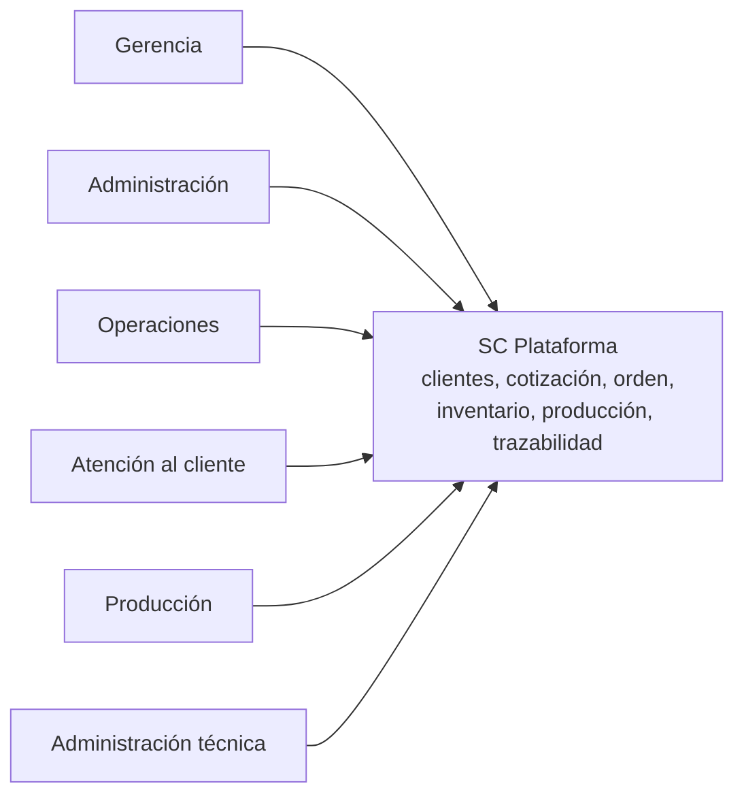
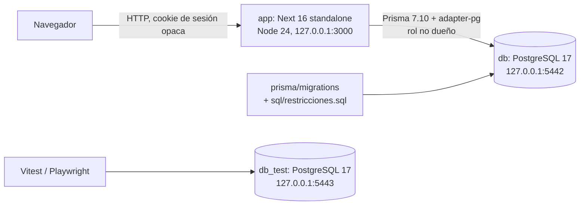
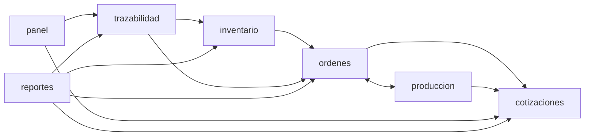
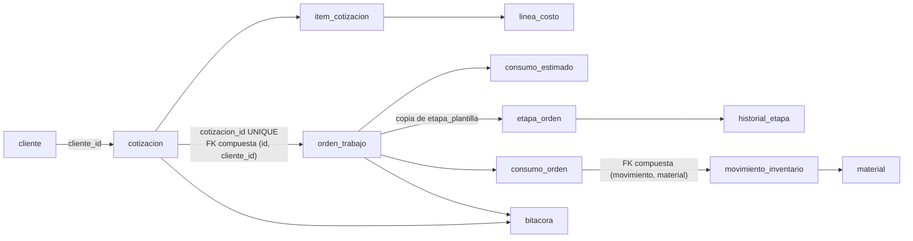
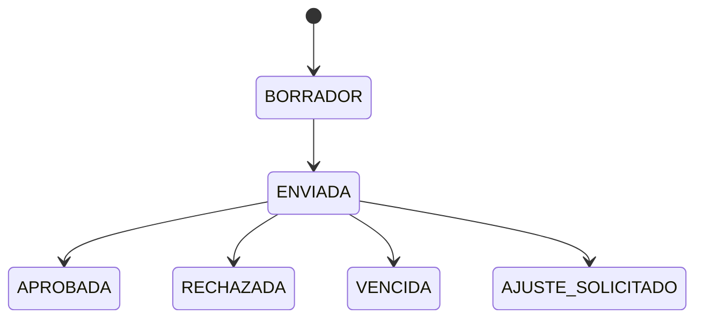
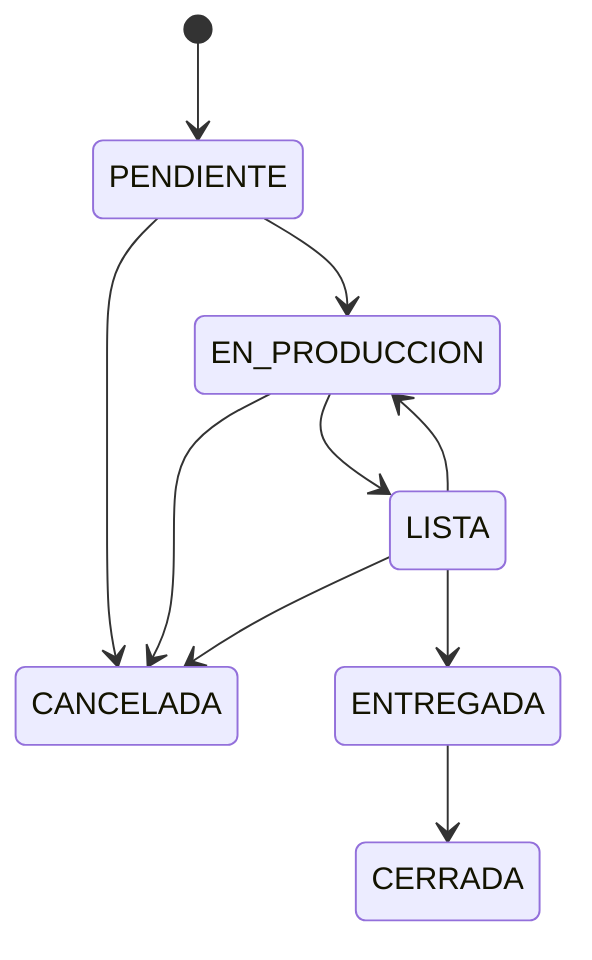
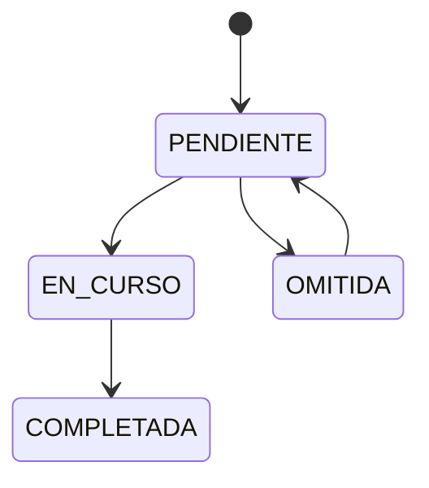

# Arquitectura del sistema: SC Plataforma

Fecha: 2026-10-11. Estado: guía para las auditorías de backend, DevOps y frontend.
Describe lo que el código hace hoy. No propone rediseño. Cada brecha se marca como **brecha**.
Autor: agente `arquitecto`. Verificación del orquestador: las brechas 5 y 6 de la sección 9 se confirmaron en `restricciones.sql:442,447,532-533`. El resto se verifica en las partes 2.x.
Fuentes: `docs/auditoria/0-linea-base.md`, `docs/auditoria/1-inventario.md`, `AGENTS.md`, `prisma/schema.prisma`,
`prisma/sql/restricciones.sql`, `src/core/permisos.ts`, `src/lib/http.ts`, `src/modules/inventario/consumo*.ts`,
`src/modules/ordenes/conversion.ts`, `docs/decisiones.md` (ADR-001 a ADR-014).

## 1. Contexto y contenedores

### Nivel 1: contexto
- Sistema web de Soluciones Creativas, Estelí (`AGENTS.md:3-5`).
- Integra clientes, cotización, orden, inventario, producción y trazabilidad.
- Seis perfiles de usuario (`src/core/permisos.ts:1-7`).
- No hay integraciones externas en las fuentes leídas.

### Nivel 2: contenedores
- `app`: Next 16 con `output: standalone` y Node 24 en Docker. Expone 127.0.0.1:3000 (`0-linea-base.md:10,14`, `AGENTS.md:15,74`).
- `db`: PostgreSQL 17 en 127.0.0.1:5442. `db_test` en 127.0.0.1:5443 (`0-linea-base.md:15-16`).
- Acceso a datos: Prisma 7.10.0 con `@prisma/adapter-pg` (`AGENTS.md:14`). La URL vive en `prisma.config.ts` (`schema.prisma:4`).
- La aplicación se conecta con un rol que no es dueño de las tablas (ADR-009, `docs/decisiones.md:16`).
- El esquema se define en `prisma/migrations/`. Las reglas viven en `prisma/sql/restricciones.sql` (`schema.prisma:3`).

- **Brecha (DevOps):** el desarrollo local usa Node 26.4 (`0-linea-base.md:7,24`). ADR-010 dice que Prisma 7.10 no soporta Node 26 (`docs/decisiones.md:17`).
- **Brecha (DevOps):** `restricciones.sql` y la migración `20261011015300` repiten la tabla de transiciones (`1-inventario.md:17`). No hay un control que detecte la deriva entre ambas.

## 2. Componentes por capa (nivel 3)

| Capa | Ruta | Responsabilidad real |
|---|---|---|
| app | `src/app/api/v1/**/route.ts` | 71 rutas y 89 handlers. Ningún DELETE (`1-inventario.md:7`). Todos pasan por `manejar`, salvo `salud`. |
| app | `src/app/(app)/**/page.tsx` | Páginas de servidor. Tres usan `prisma` directo: `reportes/page.tsx:6`, `cotizaciones/nueva/page.tsx:4`, `cotizaciones/[id]/imprimir/page.tsx:6`. |
| modules | `src/modules/<m>/` | `service.ts`, `schema.ts` (zod), `repo.ts`, DTO y `componentes/` de UI (`AGENTS.md:22`). |
| core | `src/core/` | Reglas puras: `permisos.ts`, `autorizacion.ts` (`can`, `exigir`), `costeo.ts`, `consumo-estimado.ts`. |
| lib | `src/lib/` | `http.ts` (`manejar`, `ok`, `leerJson`), `db` (`prisma`, `Tx`), `auth/*`, `errores`, `bitacora`. |
| base de datos | `prisma/` | Enums, FK, UNIQUE (`schema.prisma`). CHECK, triggers y funciones (`restricciones.sql`). |

Flujo de una petición en `manejar` (`src/lib/http.ts:63-85`):
1. Verifica Origin en POST, PUT, PATCH y DELETE. Sin Origin, acepta solo con `NODE_ENV=test` (`:17-31`).
2. Carga la sesión. Sin sesión responde 401 (`:33-37`).
3. Exige clave cambiada (`:38`). Exige el permiso si la ruta lo declara (`:39`).
4. Ejecuta el handler. `leerJson` responde 400 si el JSON es inválido y 422 si zod falla (`:100-119`).
5. Traduce el error con `aErrorHttp`. Escribe log solo en 5xx (`:43-55`).

- **Brecha:** el `peticionId` solo llega al log. No vuelve al cliente (`http.ts:51`).
- **Brecha:** `origenPermitido` compara contra el encabezado `host` (`http.ts:25`). Detrás de un proxy, verificar `Host` y TLS.
- **Brecha:** `manejar` no limita la tasa de peticiones. Solo el login tiene bloqueo (`schema.prisma:246-247`).

## 3. Límites de módulos y reglas de dependencia

Reglas declaradas:
- `core` no usa Next ni la base de datos (`AGENTS.md:21`).
- El handler es delgado: valida, autoriza, llama al servicio y responde (`AGENTS.md:38`).
- El servidor decide la autorización con `can`. La interfaz solo oculta (`AGENTS.md:43`).

Grafo real de imports de servidor entre módulos (búsqueda de `@/modules/` en `src/modules`):

- Hojas sin imports a otros módulos: `clientes`, `cotizaciones`, `catalogo`, `auth`. `admin` solo importa `clientes` desde UI.
- `inventario` depende de `ordenes` para errores y resumen (`consumo-bloqueo.ts:4`, `resumen-orden.ts:4`).
- Los componentes de UI de `inventario`, `ordenes` y `produccion` importan de `cotizaciones`. Ejemplos: `inventario/componentes/FormularioLibro.tsx:8`, `produccion/useSolicitudProduccion.ts:7`.
- **Brecha:** hay un ciclo de módulos `ordenes` <-> `produccion` (`ordenes/estados.ts:3`, `produccion/estados.ts:2-3`). El análisis por archivo (`scripts/auditoria/ciclos.mjs`) no lo ve como ciclo de archivos.
- **Brecha:** `core` importa `lib/errores` (`core/autorizacion.ts:1`, `core/costeo.ts:1`). La capa pura depende de `lib`.
- **Brecha:** `cotizaciones` funciona como librería de UI compartida sin declararlo. Falta verificar qué se comparte.
- **Brecha:** las páginas con `prisma` directo saltan `modules` y `manejar` (sección 2). Falta verificar cómo autorizan.

## 4. Linaje del dato

- Cliente -> cotización: `cliente_id` (`schema.prisma:488,518`). Una versión corregida enlaza su origen con `cotizacion_origen_id` (`:493`, ADR-014).
- La cotización guarda tasa, subtotal, impuesto y total (`schema.prisma:495-500`). El ítem copia el precio base (`:552-553`).
- Cotización -> orden: `cotizacion_id` UNIQUE (`schema.prisma:599`). La FK compuesta fuerza el mismo cliente (`:615`, `:535`).
- La conversión crea la orden, el estimado, las etapas y la bitácora en una transacción (`conversion.ts:47-67`).
- Las etapas copian nombre, área y secuencia de la plantilla (`conversion.ts:60-62`, `schema.prisma:680`).
- Consumo -> movimiento: `consumo_orden` enlaza orden, material y movimiento (`schema.prisma:443-462`).
- Un trigger copia cantidad y costo desde el movimiento (`restricciones.sql:467-479`).
- Etapa -> `historial_etapa` de solo inserción (`schema.prisma:637-659`).
- Bitácora: `orden_id` y `cotizacion_id` con FK. `entidad_id` sin FK (`schema.prisma:719-721`).
- **Brecha:** `consumo_orden` no enlaza a la etapa (`schema.prisma:443-462`). Falta decidir si es diseño.
- **Brecha:** `bitacora.entidad_id` es polimórfico y sin FK (`schema.prisma:719`). Puede dejar eventos huérfanos. La consulta INV-01 de 2.2 no encontró ninguno.
- **Brecha:** la orden no copia precios ni costos (`conversion.ts:52-55`).
- **Brecha:** el estimado se guarda al convertir (`conversion.ts:41-45,56`). El inventario dice que usa la receta vigente (`ordenes/estimado.ts:14-16`). Falta verificar si alguna lectura lo recalcula.

## 5. Máquinas de estado

La fuente en la base es `transicion_valida` (`restricciones.sql:493-523`). El trigger `fn_validar_transicion` (`:525-559`) la aplica con SQLSTATE SC002.
Espejos en TS: `cotizaciones/estados.ts:14-18`, `ordenes/reglas.ts:24-27`, `produccion/reglas.ts:5-15`.

- Estados terminales de cotización: APROBADA, RECHAZADA, VENCIDA y AJUSTE_SOLICITADO.
- La versión corregida nace por duplicación (`docs/decisiones.md:57`).
- `archivada` es una bandera aparte, no un estado (`schema.prisma:513`).
- Una actualización al mismo estado pasa sin error (`restricciones.sql:532-533`, verificado).
- **Brecha:** `restricciones.sql:490` cita `src/core/estados.ts`, que no existe.
- **Brecha:** no hay prueba TS/BD de transiciones para la orden (`1-inventario.md:24`).
- **Brecha:** algunos cambios de estado usan guardas propias fuera de `exigirTransicion`: `ordenes/estados.ts:36`, `produccion/estados.ts:19,32`, `produccion/etapas.ts:90`.

## 6. Fronteras transaccionales y bloqueos

Aislamiento por defecto: READ COMMITTED (`consumo-bloqueo.ts:10`).

| Operación | Transacción | Bloqueos (en orden) | Respaldo en la base |
|---|---|---|---|
| Convertir cotización en orden | `conversion.ts:72` | cotización FOR UPDATE (`:16`), categoría FOR SHARE (`:27`), áreas FOR SHARE ordenadas por id (`:33-35`) | SC004 (`sql:680-697`), UNIQUE `cotizacion_id`. Si gana otra petición, devuelve la orden ganadora (`conversion.ts:73-75`) |
| Consumo y devolución | `consumo.ts:52` | advisory lock por clave de idempotencia (`idempotencia.ts:48`), orden FOR SHARE (`consumo-bloqueo.ts:15`), materiales FOR UPDATE de uno en uno en orden ascendente (`:22-30`) | SC005 diferido (`sql:417-420`), `fn_consumo_validar` (`:427-464`), UNIQUE (clave, material) (`schema:458`) |
| Entrada y ajuste | servicio del libro | material FOR UPDATE (`inventario/libro.ts:37`, `repo.ts:9`) | saldo solo por movimiento, SC006 (`sql:377-391`) |
| Editar, entregar, cerrar y cancelar orden | servicio de órdenes | sin FOR. UPDATE condicionado a versión (`ordenes/repo.ts:75-89`) | SC002 y columnas inmutables (`sql:717-720`) |
| Etapas de producción | servicio de producción | orden y etapa FOR UPDATE (`produccion/escritura.ts:15`, `repo.ts:10,16`) | SC002 (`sql:556-559`), `historial_etapa` de solo inserción |
| Estados de cotización | `cotizaciones/estados.ts:22,51,73` | sin FOR | SC002 y SC003 congelado (`sql:565-599`) |
| Admin y auth | servicios | FOR UPDATE usuario, perfil, permisos y configuración. FOR NO KEY UPDATE usuario (`auth/service.ts:114,193`) | n/a |
| Trazabilidad (lectura) | `trazabilidad/service.ts:14,24,38` | REPEATABLE READ sin bloqueo | n/a |

- La cancelación usa UPDATE sobre la orden. Choca con el FOR SHARE del consumo (`consumo-bloqueo.ts:9-11`).
- La bitácora exige una transacción abierta (`lib/bitacora.ts:30-31`).
- **Brecha:** el cierre de sesión usa `updateMany` sin transacción ni bitácora (`auth/service.ts:163-166`).
- **Brecha:** los estados de cotización no toman FOR. La no-op al mismo estado (sección 5) deja a la comprobación de versión como única defensa contra una doble aprobación. La parte 2.5 la prueba con dos clientes.

## 7. Matriz perfil × operación (`src/core/permisos.ts:87-150`)

GER = Gerencia. ADM = Administración. OPE = Operaciones. ATC = Atención al cliente. PRO = Producción. TEC = ADMIN (Administración técnica).

| Permiso | GER | ADM | OPE | ATC | PRO | TEC |
|---|---|---|---|---|---|---|
| cliente:ver / gestionar | V / – | – / – | V / – | V / V | – / – | – / – |
| catalogo:ver / gestionar | V / – | V / – | V / V | V / – | V / – | – / – |
| cotizacion:ver | V | V | V | V | – | – |
| cotizacion:gestionar, enviar | – | – | – | V | – | – |
| cotizacion:responder | – | – | V | V | – | – |
| orden:ver | V | V | V | V | V | – |
| orden:crear, cancelar | – | – | V | – | – | – |
| orden:gestionar | – | V | V | – | – | – |
| orden:avanzar | – | V | V | – | V | – |
| orden:entregar, cerrar | – | – | V | V | – | – |
| produccion:ver | V | V | V | V | V | – |
| produccion:planificar | – | V | V | – | – | – |
| produccion:ejecutar | – | V | – | – | V | – |
| inventario:ver | V | V | V | – | – | – |
| inventario:entrada, consumir, ajustar; material:gestionar | – | V | – | – | – | – |
| bitacora:ver | V | – | – | – | – | V |
| panel:ver | V | V | V | V | V | – |
| reporte:ver, exportar | V | – | – | – | – | – |
| usuario, permiso, configuracion:gestionar | – | – | – | – | – | V |

- Un usuario con varios perfiles recibe la unión de permisos (`schema.prisma:190`). El perfil principal sigue el orden de `PERFILES` (`permisos.ts:9,40-44`).
- La matriz es solo el valor por defecto. TEC la edita en la base (`permisos.ts:86`).
- La visibilidad de costos en consumo depende de `cotizacion:ver` (`consumo.ts:55,94`).
- **Brecha:** ADR-014 sigue "propuesto" en la bóveda, con la aprobación de Norman pendiente de registrar. El código ya lo aplica.
- **Brecha:** TEC tiene `permiso:gestionar`. Podría otorgarse permisos de negocio. "No hereda operaciones" solo vale por defecto (`permisos.ts:31`).
- **Brecha:** no existe un permiso propio para costos. `cotizacion:ver` cumple esa función de forma implícita (hallazgo 2.6: la receta del catálogo ya se filtra con esa regla).

## 8. Invariantes

Los garantiza la base:
- Transiciones válidas de cotización, orden y etapa: SC002 (`restricciones.sql:493-559`).
- Solo inserción en `bitacora`, `movimiento_inventario` y `consumo_orden`: SC001 (`sql:265-291`).
- `historial_etapa` es de solo inserción según `schema.prisma:638`.
- `material.existencia` cambia solo por movimiento. `costo_promedio` cambia solo por ENTRADA si hay existencia: SC006 (`sql:377-391`).
- Todo CONSUMO o DEVOLUCION tiene su `consumo_orden` al COMMIT: SC005 diferido (`sql:403-420`).
- La devolución no supera lo consumido por orden y material: SC005 (`sql:452-460`).
- Cantidad y costo del consumo se copian del movimiento (`sql:467-479`).
- Fuera de BORRADOR, la cotización y sus ítems y líneas quedan congelados. Los totales cuadran: SC003 (`sql:565-662`).
- La orden exige una cotización APROBADA: SC004 (`sql:680-697`). Hay una orden por cotización (`schema.prisma:599`).
- La orden tiene el mismo cliente que su cotización (`schema.prisma:535,615`).
- El consumo usa el mismo material que su movimiento (`schema.prisma:433,455`).
- Columnas inmutables en orden, cotización y etapa: SC007 (`sql:717-730`).
- La numeración no tiene huecos (`schema.prisma:772-780`). El rol de la app no es dueño de las tablas (ADR-009).

Los garantiza solo el código:
- Autorización por permiso: `manejar` (`http.ts:39`) y `exigir` en servicios (`consumo.ts:47`, `conversion.ts:70`).
- Clave temporal cambiada (`http.ts:38`). Origen permitido (`http.ts:21-31`).
- No convertir una cotización archivada (`conversion.ts:21`). Categoría activa, plantilla y áreas activas (`conversion.ts:28-37`).
- Fecha de entrega válida (`conversion.ts:71`). Responsable válido (`conversion.ts:50`).
- Una fila de bitácora en cada cambio de negocio (`AGENTS.md:44`). Ningún trigger la exige.
- Orden fijo de bloqueos e idempotencia por huella normalizada (`consumo.ts:45-54`, `consumo-bloqueo.ts:1-2`).
- Ocultar costos a quien no tiene `cotizacion:ver` (`consumo.ts:35-41`).
- Estado de la orden para consumos con fecha histórica. La base solo valida movimientos con menos de 1 hora (`sql:426,442,447`, verificado).

## 9. Riesgos y brechas para auditar

P1 = auditar primero: autorización o dinero sin respaldo de la base. P2 = integridad o gobierno. P3 = mantenimiento.
Ningún punto es un defecto demostrado hasta que lo confirme la parte indicada.

P1
1. `ordenes/[id]` PATCH decide el permiso dentro del handler (`route.ts:9-11`). `ordenes/opciones` no declara permiso (`route.ts:4`). Parte 2.6: sin hallazgo.
2. El cliente puede enviar el costo unitario de una línea de material (`cotizaciones/schema.ts:47`, `costear.ts:85`). Parte 2.7.
3. TEC puede ampliarse la matriz con `permiso:gestionar` (`permisos.ts:31,86`). Verificar si hay guarda o bitácora. Parte 2.4.
4. `ordenes/repo.ts:75-89` y `produccion/repo.ts:38-48` aceptan `estado` en escritura genérica. La base solo valida la transición, no la regla de negocio. Parte 2.4.

P2
5. Carrera en los estados de cotización sin FOR, con no-op al mismo estado (`cotizaciones/estados.ts:22,51,73`, `sql:532-533`). Parte 2.5.
6. La validación de estado en consumo exime los movimientos con más de 1 hora (`sql:442,447`). Parte 2.4.
7. La bitácora completa depende del código. El logout no la escribe (`auth/service.ts:163-166`). Parte 2.4.
8. Falta la prueba TS/BD de transiciones de la orden (`1-inventario.md:24`). Parte 2.4.
9. Tabla de transiciones duplicada en `restricciones.sql` y en la migración `20261011015300`. Parte 3.
10. Node 26 local frente a Node 24 en Docker, en contra de ADR-010 (`0-linea-base.md:24`). Parte 3.1.
11. ADR-014 aplicado sin aprobación registrada en la bóveda. Gobierno.
12. Tres páginas usan `prisma` directo, sin `manejar` (`reportes/page.tsx:6`, `cotizaciones/nueva/page.tsx:4`, `cotizaciones/[id]/imprimir/page.tsx:6`). Verificar la autorización. Fase 4.2.

P3
13. Ciclo de módulos `ordenes` <-> `produccion` (`ordenes/estados.ts:3`, `produccion/estados.ts:2-3`).
14. `core` depende de `lib/errores` (`core/autorizacion.ts:1`, `core/costeo.ts:1`).
15. `consumo_orden` sin etapa. `bitacora.entidad_id` sin FK (`schema.prisma:443-462,719`).
16. El estimado se guarda al convertir, pero puede recalcularse con la receta vigente (`conversion.ts:56`, `ordenes/estimado.ts:14-16`).
17. Costos condicionados a `cotizacion:ver` (`consumo.ts:55,94`).
18. `peticionId` sin respuesta ni correlación. Sin límite de tasa. `host` sin soporte de proxy (`http.ts:25,51`).
19. `solicitud_idempotente.clave` es global, no por usuario (`schema.prisma:759`). Verificar el rechazo de claves ajenas.
20. `restricciones.sql:490` cita un archivo inexistente.
21. Los componentes de UI importan de `cotizaciones` como librería compartida (`inventario/componentes/FormularioLibro.tsx:8`).
